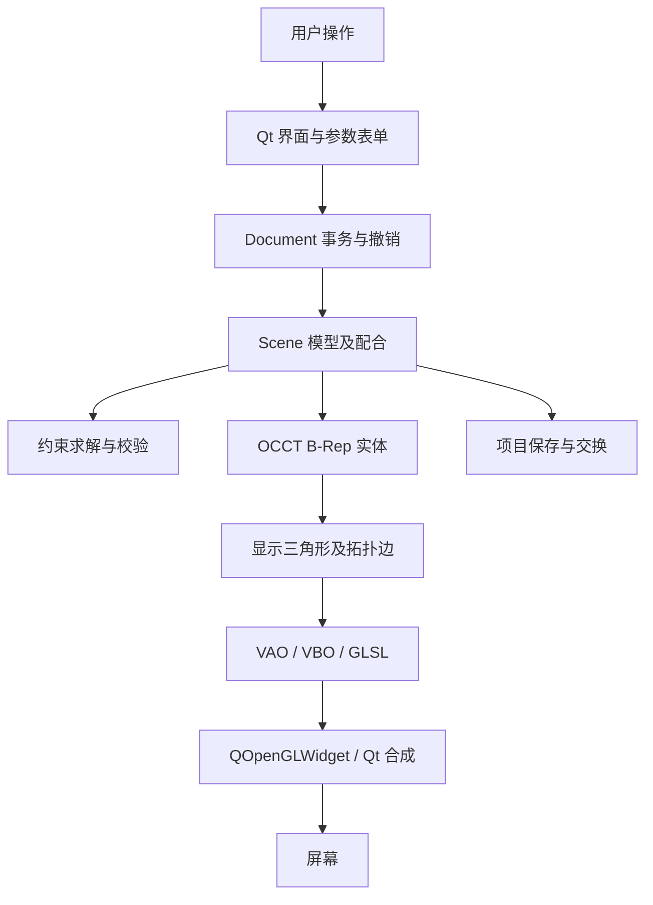
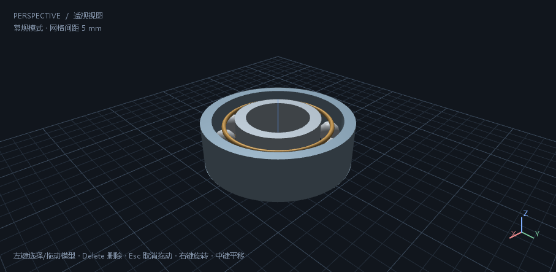
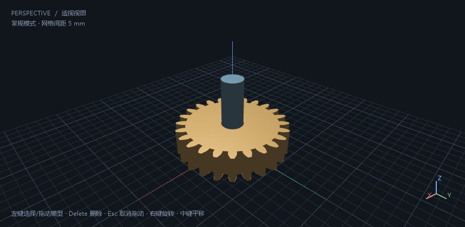
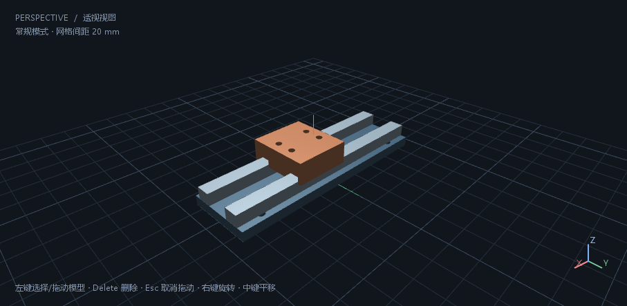

<div align="center">

# AxisForge CAD

**用参数构建实体，用配合组织装配。**

1.0.1 · C++17 · Qt Widgets · OpenGL 3.3 Core · Open CASCADE Technology

[下载正式版](https://github.com/13536309143/AxisForge-CAD/releases/tag/v1.0.1) · [构建与测试](https://github.com/13536309143/AxisForge-CAD/actions) · [模型参数](docs/MODELING_PARAMETERS.md) · [配合与地板](docs/MATES_AND_GRID.md) · [网格交换](docs/MESH_EXCHANGE.md)

</div>


AxisForge CAD 是可运行、可构建、可测试的轻量三维 CAD 桌面项目。用户可以在创建前设置模型尺寸与细分，编辑外观和位姿，执行实体布尔运算，建立装配配合，并交换 STEP、GLB、OBJ 等文件。

项目把 **Qt 界面、文档事务、几何内核、装配求解和 OpenGL 显示**分层实现，适合学习桌面三维软件的完整开发流程，也可作为几何工具与装配查看器的基础。1.0.1 整合当前实现及构建、部署和验证流程；草图约束、完整特征历史和通用工业装配求解仍属于后续方向。

## 目录

- [快速运行](#快速运行)
- [功能与技术栈](#功能与技术栈)
- [Windows 完整构建](#windows-完整构建)
- [Linux 完整构建](#linux-完整构建)
- [Qt Creator](#qt-creator)
- [Qt 界面与文档架构](#qt-界面与文档架构)
- [OpenGL 渲染与交互](#opengl-渲染与交互)
- [OCCT 实体与布尔运算](#occt-实体与布尔运算)
- [参数建模](#参数建模)
- [装配配合与固定地面](#装配配合与固定地面)
- [文件格式与兼容](#文件格式与兼容)
- [性能统计](#性能统计)
- [测试与正式发布](#测试与正式发布)
- [源码导航与学习顺序](#源码导航与学习顺序)
- [常见问题](#常见问题)
- [范围与后续方向](#范围与后续方向)
- [许可与参考资料](#许可与参考资料)

## 快速运行

1. 从 [v1.0.1 Release](https://github.com/13536309143/AxisForge-CAD/releases/tag/v1.0.1) 下载 `AxisForge-CAD-1.0.1-Windows-x64.zip`。
2. 解压整个目录。若系统尚未安装适用的 Microsoft Visual C++ x64 运行库，运行包内的 `VC_redist.x64.exe`。
3. 双击 `start.cmd`。启动默认展示示例装配，也可打开 `examples` 中的项目。
4. 点击建模按钮，填写该类型的参数，确认后创建；取消不会改变场景。

运行包包含 Qt、OCCT 所需的动态库、平台插件和资源，不要求安装开发环境。**不要只复制 EXE**，需保留整个 `run` 目录。显卡驱动须提供 OpenGL 3.3 Core 或更高版本；运行库不能替代显卡驱动。

发布页还提供 `AxisForge-CAD-1.0.1-Source.zip` 与 `SHA256SUMS.txt`。源码包用于开发，不能直接当作运行包。可核对下载内容：

```powershell
Get-FileHash .\AxisForge-CAD-1.0.1-Windows-x64.zip -Algorithm SHA256
```

### 常用操作

| 操作 | 输入 |
| --- | --- |
| 选择／拖动模型 | 左键；固定模型拒绝直接拖动 |
| 旋转／平移／缩放视角 | 右键拖动／中键拖动／滚轮 |
| 适配全部 | `F` |
| 等轴测／前／右／顶视图 | `1` / `2` / `3` / `4` |
| 创建前五种基本模型 | `Ctrl+1`～`Ctrl+5`，打开参数窗口 |
| 添加／编辑配合 | `Ctrl+M` / `Ctrl+Shift+M` |
| 地面对齐配合 | 选择模型后“对齐地板”或 `Ctrl+G` |
| 保存／复制／撤销 | `Ctrl+S` / `Ctrl+D` / `Ctrl+Z` |
| 删除／取消拖动 | 对应树或视口中的 `Delete` / `Esc` |
| 四种显示模式 | `Alt+1`～`Alt+4` |
| 恢复属性／统计面板 | `Ctrl+I` / `Ctrl+Shift+I` |

## 功能与技术栈

| 模块 | 1.0.1 能力 |
| --- | --- |
| 参数建模 | 九种 OCCT 实体，创建前独立参数窗口，按类型显示属性 |
| 对象编辑 | 名称、尺寸、细分、颜色、位置、旋转、可见性和固定状态 |
| 实体运算 | 布尔并／差／交，有效性检查，体积和面积 |
| 装配 | 八种配合，场景点选 A/B，预览、修改、停用和可视化 |
| 地板 | 固定世界 Z=0，持续地面对齐，范围／密度自适应 |
| 视图 | 常规、三角面、局部包围盒、拓扑线框；透视／正交 |
| 文档 | 失败回滚，最多 100 步撤销／重做，复制和关联删除 |
| 文件 | `.afcad`、STEP、GLB、OBJ；ASCII STL 导出 |
| 统计 | 实例、显示网格、自有缓冲、进程内存、FPS 和同步状态 |
| 工程 | CMake／CTest、跨平台检查、运行库收集和 GitHub Release |

| 技术 | 项目职责 | 关键模块 |
| --- | --- | --- |
| Qt Widgets | 窗口、菜单、工具栏、停靠面板、表单和事件 | `src/ui` |
| Qt Core / Gui | 信号槽、JSON、容器、数学类型和撤销框架 | `src/core`、`src/app` |
| QOpenGLWidget | 把图形上下文和画面接入 Qt 控件 | `Viewport` |
| OpenGL / GLSL | GPU 顶点处理、深度测试、光照和线段 | `Viewport.cpp` |
| OCCT | B-Rep、布尔、属性、离散化、STEP / XDE | `Kernel`、`StepIO` |
| C++17 / CMake / CTest | 业务实现、依赖链接、编译和检查 | 全项目 |



OpenGL 不理解“圆柱”“孔”或“同轴”。OCCT 计算实体，项目将其离散为显示数据，再交给 OpenGL；Qt 把操作组织为可交互、可撤销的工作流。

## Windows 完整构建

### 1. 开发工具与版本

推荐与正式发布一致的 **x64 / MSVC / Qt 6.8.3 / OCCT 7.9.3**：

| 依赖 | 配置 |
| --- | --- |
| 系统 | 可运行所选 Qt 版本的 x64 Windows；CI 使用 Windows Server 2022 runner |
| Visual Studio 2022 | “使用 C++ 的桌面开发”、MSVC x64 与 Windows SDK |
| CMake | 建议 3.24+；项目最低 3.16，还需满足所选 Qt 要求 |
| Git | 获取源码、生成源码归档 |
| Qt | 6.8.3 `msvc2022_64`，包含 Widgets、OpenGL、OpenGLWidgets |
| OCCT | 官方 VC14 x64 SDK 及对应第三方动态库 |
| 图形驱动 | OpenGL 3.3 Core 或更高 |

通过 Qt 官方安装工具安装相应 MSVC 组件，不要混用 MinGW／MSVC 或 x86／x64。项目保留 Qt 5.15 支持，本机兼容验证使用 5.15.2，正式 Windows 包使用 Qt 6。

**不需要先从源码编译 Qt 本身。** 官方开发包包含所需头文件、库和工具。OpenGL 由 Qt 模块与系统／显卡驱动衔接，项目无需额外引入 GLFW、GLUT、GLEW 或手工生成 GLAD。

### 2. 获取项目和 OCCT

打开 **Developer PowerShell for VS 2022**：

```powershell
git clone https://github.com/13536309143/AxisForge-CAD.git
Set-Location AxisForge-CAD
git checkout v1.0.1
$env:QT_ROOT_DIR = 'C:\Qt\6.8.3\msvc2022_64'
.\scripts\setup-occt.ps1
```

脚本下载官方 SDK 和第三方包到 `deps`，核对 SDK SHA-256 后解压，需要网络和足够磁盘空间，不修改系统 PATH。`deps` 和构建产物不提交 Git。已有 SDK 也可按以下结构准备：

```text
deps/
├─ occt/<SDK目录>/
│  ├─ cmake/OpenCASCADEConfig.cmake
│  ├─ inc/
│  ├─ src/
│  └─ win64/vc14/{bin,lib}/
└─ thirdparty/<官方第三方包解压内容>/
```

### 3. 完整构建、部署与打包

```powershell
.\scripts\package-windows.ps1
```

脚本配置 CMake，构建 Release，遍历并收集 OCCT 传递 DLL 依赖，调用 `windeployqt` 部署 Qt 插件，复制资源与许可，加入官方 VC++ 安装程序，并执行打包后核心测试：

```text
release/
├─ AxisForge-CAD/                       可运行目录
├─ AxisForge-CAD-1.0.1-Windows-x64.zip   Windows 包
├─ AxisForge-CAD-1.0.1-Source.zip        当前 Git 提交的源码归档
└─ SHA256SUMS.txt                       两个归档的校验值
```

核心测试无需显示窗口。桌面测试需要真正可呈现的 OpenGL 窗口，见测试章节。打包脚本不会自动给用户安装 VC++ 运行库。

### 4. 手动 CMake 与调试

```powershell
$qt = 'C:\Qt\6.8.3\msvc2022_64'
$occ = 'C:\SDK\opencascade-7.9.3-vc14-64'
cmake -S . -B build -G 'Visual Studio 17 2022' -A x64 "-DCMAKE_PREFIX_PATH=$qt;$occ"
cmake --build build --config Release --parallel 2
```

输出位于 `build/Release`。编译不等于部署：运行还需 Qt DLL／插件、OCCT 和第三方 DLL，以及资源路径。推荐先用上述脚本准备完整运行环境。

兼容的 `build.cmd` 不再绑定作者机器上的 Qt 路径，需显式指定：

```powershell
$env:QT_ROOT = 'C:\Qt\6.8.3\msvc2022_64'
$env:OCCT_ROOT = 'C:\SDK\opencascade-7.9.3-vc14-64'
# 若尚未部署运行目录，需将对应第三方 DLL 目录加入当前终端 PATH。
.\build.cmd
```

标准工具用法见 [Qt Windows 部署说明](https://doc.qt.io/qt-6/windows-deployment.html)。`windeployqt` 不负责解决全部 OCCT 第三方库，项目另有依赖遍历和资源收集。

## Linux 完整构建

CI 使用 Ubuntu 24.04、Qt 6 和系统 OCCT 7.6 系列开发包：

```bash
sudo apt-get update
sudo apt-get install -y build-essential git cmake ninja-build \
  qt6-base-dev libqt6opengl6-dev xvfb libgl1-mesa-dri \
  libtbb-dev libfreetype6-dev libfontconfig1-dev libfreeimage-dev \
  libocct-data-exchange-dev libocct-modeling-algorithms-dev \
  libocct-modeling-data-dev libocct-visualization-dev libocct-ocaf-dev

git clone https://github.com/13536309143/AxisForge-CAD.git
cd AxisForge-CAD
git checkout v1.0.1
cmake -S . -B build -G Ninja -DCMAKE_BUILD_TYPE=Release
cmake --build build --parallel 2
./build/AxisForgeCAD
```

桌面环境直接运行；无显示器 CI 使用：

```bash
LIBGL_ALWAYS_SOFTWARE=1 xvfb-run -a ctest --test-dir build --output-on-failure
```

软件渲染用于功能检查，不是独显性能基准。Linux 仍依赖系统动态库，不能使用 Windows ZIP。目前未提供 macOS 发布包或完成该平台验证。

## Qt Creator

打开根目录 `CMakeLists.txt`，选择匹配 Qt 的 Kit（如 MSVC 2022 x64），在 CMake 配置中设置 Qt／OCCT 的 `CMAKE_PREFIX_PATH`。确认运行环境可找到 DLL、插件和资源，再构建、运行 `AxisForgeCAD`；测试目标是 `axisforge_tests`。

Qt6 显式链接 `Qt6::OpenGLWidgets`；Widgets 提供常规界面，OpenGLWidgets 提供 QOpenGLWidget。`AUTOMOC` 处理带 `Q_OBJECT` 类的元对象代码。参见 [Qt CMake 入门](https://doc.qt.io/qt-6/cmake-get-started.html)。

## Qt 界面与文档架构

### 窗口、布局和动作

`MainWindow` 基于 `QMainWindow`，中央为三维视口，左右及底部使用 `QDockWidget`。工具栏分组，属性使用滚动表单，面板关闭后可以恢复。`QAction` 让菜单、工具栏和快捷键触发同一操作。

创建表单和右侧检查器复用 `ParameterFields.h`，只显示相关字段，统一“内半径”“顶半径”“直径”等含义。导入／布尔结果不冒充可改尺寸的参数图元。

### 信号槽与事件循环

`QApplication::exec()` 分派键鼠、重绘和定时器事件。Document 发出变更通知，主窗口同步树、属性和视口；Viewport 发出选择、拖动信号，经文档层修改场景。刷新保护避免同步控件时产生递归编辑。

当前布尔和导入等复杂计算仍同步执行，大模型可能阻塞界面。后台任务、取消进度和增量更新属于后续优化，不能把现有对象任意跨线程共享。

### 事务与撤销

编辑先在候选场景上进行校验和配合求解，成功后压入 `QUndoStack`，失败保留原场景。快照共享只读几何，减少重复复制。一次创建、拖动或配合应用形成一个撤销步骤，取消预览不写历史。

打开项目会替换文档并清理会话历史。删除模型同时删除关联配合，可整体撤销。固定对象是求解基准，不会被求解器或视口拖动自动移动。

## OpenGL 渲染与交互

### 上下文与 Qt 的连接

在创建 QApplication 前请求 OpenGL 3.3 Core、24 位深度缓冲、4 倍采样和交换间隔。Viewport 继承 QOpenGLWidget，通过 QOpenGLFunctions 使用图形函数；Qt 管理上下文和窗口合成，项目实现缓存、着色器与绘制。

初始化和绘制在 GL 回调中进行，用 `update()` 请求重绘。上下文销毁时在正确上下文中释放资源。控件使用 Qt 管理的帧缓冲，不应把绑定 FBO 0 当作通用的恢复操作。见 [QOpenGLWidget 文档](https://doc.qt.io/qt-6/qopenglwidget.html)。

### 顶点、矩阵与光照

顶点由位置和法线组成，各三个 float，共 24 字节。VBO 存载荷，VAO 描述读取方式；当前表面采用非索引绘制，所以长方体的 8 个独特角点对应 36 个提交顶点。

对象缓存表面、拓扑边、三角剖分边和包围盒线段，切换模式复用缓存。场景编辑仍可能重建整批 GPU 数据，尚未实现全面增量上传。

```text
局部坐标 → M 模型变换 → 世界坐标
世界坐标 → V 相机观察 → 相机坐标
相机坐标 → P 投影 → 裁剪、透视除法、视口 → 屏幕
gl_Position = P × V × M × vec4(position, 1)
```

法线使用法线矩阵；片段颜色结合环境光、方向漫反射、高光及选中效果。深度测试决定遮挡，面与线叠加使用偏移减轻深度冲突。配合标记／HUD 在后续 QPainter 阶段绘制。当前没有完整 PBR、纹理、透明排序和阴影系统。

### 显示与交互

| 模式 | 内容 | 用途 |
| --- | --- | --- |
| 常规 | 光照表面和选中边 | 形状、外观、装配 |
| 三角面 | 表面与剖分边 | 显示网格密度 |
| 包围盒 | 随对象位姿变换的局部盒 | 空间范围 |
| 线框 | 实体拓扑边；网格对象的三角形边 | 边界或网格结构 |

包围盒不是重算的世界轴对齐盒。线框不是完整隐藏线工程图，也不自动生成曲面经纬线，可看到部分背面边。

相机支持轨道旋转、平移、透视／正交和适配，近远裁剪随场景与查看距离调整。绘制考虑设备像素比，鼠标按 Qt 逻辑坐标解释。

拾取反投影为空间射线，在 CPU 上测试三角形或包围盒，当前无 BVH。拖动在面向相机的平面计算位移，再经配合修正；编辑配合期间左键只选择，避免误改预览位置。

## OCCT 实体与布尔运算

B-Rep 用曲面及顶点／边／面／壳／体的拓扑描述实体，显示三角形只是近似表达。Kernel 统一检查闭合性、拓扑有效性和正体积，计算属性及显示网格，处理曲面法线、面方向与绕序。体积来自实体积分，不是屏幕或网格估算。

布尔支持 `A∪B`、`A−B`、`A∩B`。先将对象放到共同世界坐标运算，再将结果表达回 A 的局部框架。结果是独立实体快照，可继续布尔和 STEP 导出；默认隐藏输入对象并保留原件。

修改 A/B 不会自动重建旧结果，尚无完整特征依赖树。空或零体积结果拒绝，不相连并集可含多个 solid。冻结实体的图元尺寸只读，仍能改名称、颜色和位姿。

## 参数建模

| 模型 | 创建前参数 |
| --- | --- |
| 长方体／正方体 | 长度 X、宽度 Y、高度 Z；相等即正方体 |
| 球体 | 半径、曲面细分 |
| 圆柱 | 半径、高度、曲面细分 |
| 圆锥 | 底面半径、高度、曲面细分 |
| 圆环 | 主半径、次半径／管半径、曲面细分 |
| 圆管 | 外半径、内半径、高度、曲面细分 |
| 圆台 | 底半径、顶半径、高度、曲面细分 |
| 椭球 | X/Y/Z 方向直径、曲面细分 |
| 楔形体 | 长度 X、宽度 Y、高度 Z |

长度使用 mm，基本尺寸 0.1～10000，细分 8～128；次／内／顶半径分别小于主／外／底半径。细分影响显示离散化，精确实体按尺寸构建。更多约定见 [参数说明](docs/MODELING_PARAMETERS.md)。

## 装配配合与固定地面

| 配合 | 含义 |
| --- | --- |
| 同轴 | 局部轴共线，保留轴向滑动和绕轴转动 |
| 平行 | 包含反平行，不约束位置 |
| 垂直 | 两轴方向正交，不约束位置 |
| 中心距离 | 两对象原点直线距离 |
| 原点重合 | 原点同位，保留姿态自由 |
| 指定夹角 | 有向轴的 0～180° 夹角 |
| 沿轴偏移 | B−A 在 A 所选正向轴上的有符号投影 |
| 地面对齐 | 最低点距固定地面 Z=0 为指定非负距离 |

选中配合会突出 A/B，画出轴线、距离或角度；双击编辑。非模态窗口支持点选、交换对象、临时预览和确认，取消不改文档。角度可能以平移到共同顶点的方向示意表示，标记会明确说明。

**地面对齐是持续配合。** 改尺寸或旋转后自动调整模型 Z，不移动地板，不锁定 X/Y 与旋转。固定且未贴地的模型需先取消固定；冲突明确提示并回滚。单个模型也能与地面配合。

地板恒为世界 Z=0，只按范围及相机调整覆盖和间距，使用 1/2/5 系列与主线，并限制线段数；不参与布尔或导出。

求解按 A→B 有向无环图传播并检查残差，拒绝闭环和未收敛组合。基准为原点与局部轴，不是任意面／边的持久引用。详见 [配合说明](docs/MATES_AND_GRID.md)。

## 文件格式与兼容

| 格式 | 导入 | 导出 | 内容与边界 |
| --- | --- | --- | --- |
| `.afcad` | 是 | 是 | 参数、冻结 B-Rep、网格、属性、位姿、配合 |
| STEP / STP | 是 | 是 | 闭合实体、对象单色／名称、最终实例位置 |
| GLB 2.0 | 是 | 是 | 静态网格、节点变换、名称、基础颜色，自动单位／轴向转换 |
| OBJ / MTL | 是 | 是 | 网格、名称、法线、对象材质色，须保留 MTL |
| ASCII STL | 否 | 是 | 可见对象世界空间三角网格，无颜色和配合 |

应用 **1.0.1** 与文件 `version` 独立：读取 version 1～6；通常实体为 2、网格为 3、扩展配合为 4、新图元为 5、地面对齐为 6。项目不保存撤销栈、相机和完整会话。

STEP 单位归一为 mm，嵌套装配展开为独立对象，不保留可编辑层级、面级多色、PMI、外部引用和本项目配合。开放曲面或游离线不符合当前实体要求。可见网格使 STEP 导出明确失败，隐藏后可导出其余实体。

GLB 米制／Y 向上与内部 mm／Z 向上读写转换，支持普通索引、交错属性、三角带／扇及节点镜像；蒙皮、morph、sparse accessor 和必需压缩扩展等拒绝。未完整保留的纹理、顶点颜色、透明度和动画会提示。OBJ 按 mm／Z 向上，支持负索引、凹多边形和同目录 MTL。

项目／STEP／网格输入有 64 MiB 级限制，场景最多 300 对象、1000 配合，网格对象共享 300 万提交顶点预算；压缩载荷在解压前检查声明大小。限制保护资源，不保证上限规模流畅。详见 [交换说明](docs/MESH_EXCHANGE.md) 及源码校验。

## 性能统计

约每 500 ms 更新。顶点数是表面提交记录，不是去重角点；三角数是显示网格，不是 B-Rep 面。包围盒模式仍保留表面缓存，数量不等于当前模式全部 draw call 的图元数。

自有 VBO 字节覆盖表面及辅助线，不包含 Qt FBO 或驱动全部资源。DXGI 本地段用量／预算与 VBO 口径不同，预算不是显卡总容量；驻留内存／私有提交也不等于纯几何或堆内存。

FPS 计数 `frameSwapped` 事件，帧时间为 `1000/FPS`，不是 GPU 计时。静止按需绘制时低 FPS 正常；比较时需开启连续渲染，保持场景、相机、窗口和硬件一致。

同步在创建上下文前请求，改变后“应用并重启”，或传入 `--vsync=0/1`。驱动或合成器可能覆盖请求，设置值不能独立证明实际硬件状态。

## 测试与正式发布

当前基线为 **111 项核心检查，两种同步模式各 210 项桌面检查**；1.0.1 重新构建与验证，记录见 [测试报告](docs/TESTING.md) 和 [Actions](https://github.com/13536309143/AxisForge-CAD/actions)。

```powershell
# 推荐：使用完整部署目录，保证 DLL、插件和资源与被测程序在一起
Set-Location release\AxisForge-CAD
.\test.cmd

# 开发环境已配置 DLL / 插件 / OCCT 资源路径时，在仓库根目录运行
ctest --test-dir build -C Release --output-on-failure
```

覆盖解析体积、布尔、配合／回滚、文件兼容、交换／坏输入、键鼠交互、参数窗口、撤销、地板和统计，生成 PNG／JSON。桌面测试窗口须实际呈现，隐藏或最小化会影响帧事件。

发布先通过 Linux Qt6 核心／桌面检查，再在 Windows Qt6／官方 OCCT SDK 构建、部署和检查打包后核心测试，最后生成源码包、校验文件与 Release。Windows CI 未把 runner 当作真实 GPU 性能平台。

## 源码导航与学习顺序

```text
src/
├─ main.cpp                     启动、上下文格式、命令行
├─ core/
│  ├─ Scene.*                   场景与校验
│  ├─ ParameterFields.h         模型字段定义
│  ├─ Kernel.*                  实体、属性、布尔、离散化
│  ├─ Geometry.*                网格、边界、拾取
│  ├─ Constraints.*             配合与残差
│  ├─ Presentation.*            标记及地板方案
│  ├─ ProjectIO.*               项目及兼容导出
│  ├─ StepIO.cpp                STEP / XDE
│  └─ MeshIO.*                  GLB / OBJ 和网格持久化
├─ app/Document.*               事务、撤销、创建、拖动
├─ render/Viewport.*            OpenGL、相机、交互
├─ render/MateOverlay.cpp       配合标记
└─ ui/
   ├─ MainWindow.*              工作台与动作
   ├─ CreateBodyDialog.cpp      创建前参数
   └─ MateEditor.cpp            配合预览编辑
tests/                          核心检查和夹具
docs/                           使用、依赖、测试说明
examples/                       示例项目和交换文件
scripts/                        SDK 准备与发布打包
```

建议 `main → MainWindow → CreateBodyDialog → Document → Scene → Viewport → Kernel → Constraints → 文件交换 → tests`。先追踪一次创建与撤销，再进入渲染及实体算法。

## 常见问题

| 现象 | 优先检查 |
| --- | --- |
| 找不到 Qt / OpenGLWidgets | 安装组件、前缀、Kit 与架构 |
| 找不到 OpenCASCADEConfig | SDK 解压层级与根目录 |
| 缺 DLL | 完整运行目录、OCCT 第三方库、VC++ 运行库 |
| 平台插件错误 | 保留 `platforms/qwindows.dll`，避免混用 Qt 版本／插件路径 |
| 黑屏／着色器失败 | 实际驱动、渲染错误、OpenGL 3.3 Core |
| 属性面板不见 | 菜单恢复或 Ctrl+I |
| 地面对齐失败 | 选中模型、取消固定、检查配合冲突 |
| 拖动后返回 | 固定状态或配合投影修正了位移 |
| 线框没有经纬线 | 看剖分请切三角面，实体线框是拓扑边 |
| 导入实体图元参数不可改 | 冻结几何仍可改外观和位姿 |
| OBJ 没颜色 | 一起保留引用的 MTL，纹理不是完整支持的流程 |
| 静止 FPS 低 | 按需绘制，连续渲染后再测 |

## 范围与后续方向

未实现草图约束、拉伸／旋转特征树、自动历史重建、稳定面级引用、通用闭环装配、完整曲面编辑、工程图、IGES、完整 PBR／动画和大型场景空间索引。布尔是独立快照，网格不会自动成为实体。

后续适合推进后台任务、GPU 增量更新／BVH、草图与特征依赖、面级基准及通用约束。现有检查不代表覆盖所有复杂工业模型、显卡或恶意几何。

## 许可与参考资料

原创代码采用 [MIT](LICENSE)。Qt、OCCT 和第三方库遵循各自许可；OCCT 为 LGPL 2.1 加例外。运行包保留文件，详见 [DEPENDENCIES.md](docs/DEPENDENCIES.md)。官方 VC++ 安装程序遵循自身条款，不自动执行。

- [Qt QOpenGLWidget](https://doc.qt.io/qt-6/qopenglwidget.html)：绘制生命周期。
- [Qt CMake](https://doc.qt.io/qt-6/cmake-get-started.html)：模块与构建。
- [Qt Windows 部署](https://doc.qt.io/qt-6/windows-deployment.html)：部署工具。
- [OCCT 7.9.3](https://github.com/Open-Cascade-SAS/OCCT/releases/tag/V7_9_3)：Windows SDK 来源。
- [glTF 2.0](https://registry.khronos.org/glTF/specs/2.0/glTF-2.0.html)：GLB 规范。

Qt 新接口和要求请查看对应版本文档，实现以本仓库源码为准；历史专题文档保留其编写时的版本说明。


## 1.0.1 渲染优化

新增自动三档实体 LOD、对象级视锥剔除及 GPU 网格复用；场景统计可独立开关并查看每帧提交数量。使用范围、算法与验证见 [渲染优化说明](docs/RENDER_OPTIMIZATION.md)。此更新随 1.0.1 发布。


## 机械模型示例

从菜单“示例”打开滚珠轴承、直齿轮和双轨直线导向组件；或直接打开 examples/mechanical 下的 .afcad。每例提供 STEP、GLB 和预览，包含尺寸、构成、配合和设计边界说明。详见 [机械示例指南](examples/mechanical/README.md)。

| 轴承 | 齿轮 | 导轨 |
| --- | --- | --- |
|  |  |  |

提供 tools/generate_examples.cpp 复现生成过程。模型为教学示意，不是标准件制造图纸，不含强度、公差或接触仿真。

