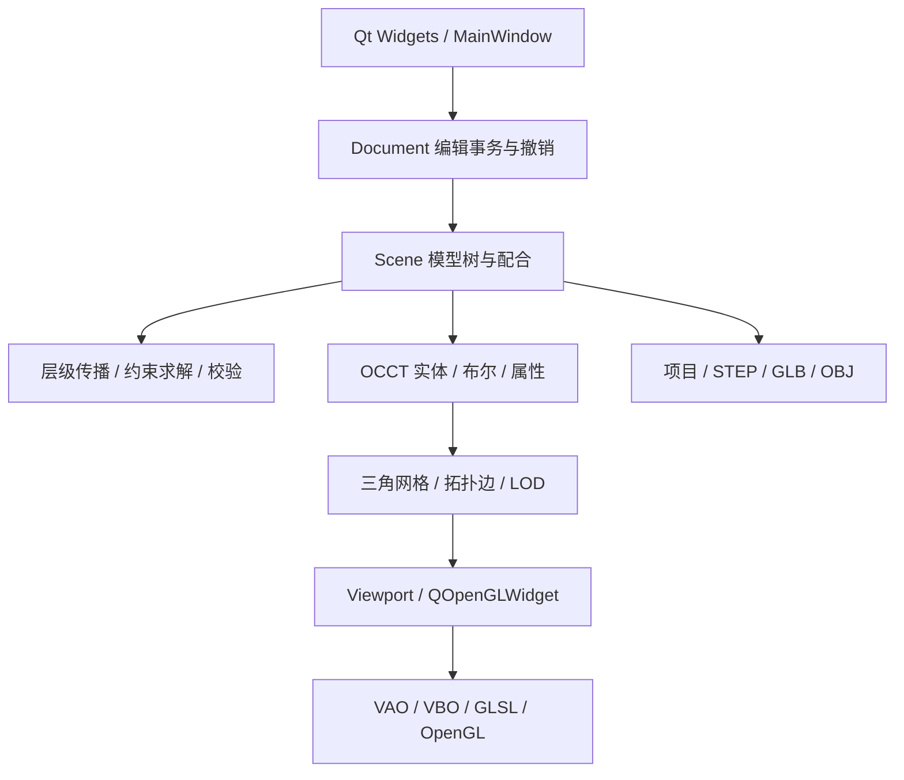

<div align="center">

# AxisForge CAD

### 参数实体 · 层级装配 · 实时三维视图

**1.0.2** · C++17 · Qt Widgets · OpenGL 3.3 Core · Open CASCADE Technology

[下载正式版](https://github.com/13536309143/AxisForge-CAD/releases/tag/v1.0.2) · [构建与测试](https://github.com/13536309143/AxisForge-CAD/actions) · [机械示例](examples/mechanical/README.md) · [模型树](docs/HIERARCHY.md) · [项目格式](docs/PROJECT_FORMAT.md)

</div>


AxisForge CAD 是一款轻量三维 CAD 桌面工作台：以 OCCT 实体为建模基础，用层级模型树组织装配，通过 Qt 完成编辑事务与交互，由 OpenGL 显示几何、配合和辅助标记。

你可以设置参数创建零件，将零件放入空节点组成装配，再对节点建立配合。父节点的平移、旋转和配合运动会传递到子树；同一份场景还可执行实体布尔、保存项目、交换 STEP 或网格文件。

**1.0.2 是新的项目格式起点。** `.afcad` 统一使用格式 **8**，只读取当前格式，不包含旧格式兼容与自动迁移。应用版本与文件格式编号是两个独立概念，随包示例全部采用当前格式。

## 导航

[快速开始](#快速开始) · [能力总览](#能力总览) · [层级与配合](#层级与配合) · [机械示例](#机械示例) · [渲染与性能](#渲染与性能) · [数据与交换](#数据与交换) · [架构与源码](#架构与源码) · [完整构建](#完整构建) · [验证与发布](#验证与发布) · [实现边界](#实现边界)

## 快速开始

### Windows 运行包

从 [v1.0.2 Release](https://github.com/13536309143/AxisForge-CAD/releases/tag/v1.0.2) 下载 `AxisForge-CAD-1.0.2-Windows-x64.zip`，完整解压后运行 `start.cmd`。保留 Qt 插件、OCCT 资源、示例与动态库，不要只复制 exe。

系统缺少 VC++ 运行库时先安装包内微软官方 `VC_redist.x64.exe`。显卡驱动需支持 **OpenGL 3.3 Core**。运行包包含应用运行依赖，不包含 Qt／OCCT 开发 SDK 或显卡驱动。

首次体验建议打开 **示例 → 轴承（层级装配）**：展开总装，选择滚珠组，修改父节点位姿，再观察整组运动。切换三角面、线框与包围盒，比较实体拓扑与显示网格。

| 操作 | 入口 |
| --- | --- |
| 选择／拖动 | 左键；选中空节点后拖动其后代几何可移动子树 |
| 相机旋转／平移／缩放 | 右键拖动／中键拖动／滚轮 |
| 取消拖动／删除 | Esc／Delete，按当前焦点处理 |
| 空节点与父子挂接 | “模型树”菜单或树的右键菜单；支持树内拖放 |
| 编辑属性 | 右侧修改后点击“应用参数” |
| 恢复属性／统计面板 | Ctrl+I／Ctrl+Shift+I 或对应面板入口 |
| 同步模式 | 统计面板选择后“应用并重启” |

### 一个建模流程

创建 `80 × 50 × 20 mm` 长方体与半径 `8 mm`、高度 `40 mm` 的圆柱，调整位姿使圆柱贯穿底座，执行“底座 − 圆柱”差集。结果是独立 B-Rep 实体，可继续布尔、移动和 STEP 导出；原对象可保留并隐藏。之后改变原圆柱半径不会自动重建孔。

新建根空节点，把零件挂到它下面，再以空节点参与装配。选择配合可以查看源／目标高亮与轴线、距离或角度标记。关系冲突或形成依赖环时，编辑会被拒绝并回滚。

## 能力总览

| 模块 | 当前能力 | 关键说明 |
| --- | --- | --- |
| 参数实体 | 长方体、球、圆柱、圆锥、圆环、圆管、圆台、椭球、楔体 | 创建前按类型显示尺寸与细分字段 |
| 属性 | 名称、参数、颜色、世界位姿、显示、固定 | 参数实体、冻结实体、网格、空节点分别处理 |
| 模型树 | 普通模型和空节点均可拥有子节点；嵌套、挂接、脱离 | 变换传播；挂接保留世界位姿 |
| 配合 | 同轴、平行、垂直、中心距离、原点重合、夹角、沿轴偏移、地面 | 对象原点与局部轴；有向依赖与残差校验 |
| 实体布尔 | 并集、差集、交集 | 结果为独立快照；失败不提交 |
| 显示 | 常规、三角面、拓扑线框、包围盒；透视／正交 | 实体拓扑边与三角形边分开保存 |
| 性能 | 三档实体 LOD、视锥剔除、GPU 网格复用 | 独立开关与实际提交统计 |
| 数据 | `.afcad`、STEP、GLB、OBJ；ASCII STL 导出 | 工程保存与几何交换有不同语义 |
| 编辑历史 | 事务、失败回滚、撤销／重做、拖动预览 | 一次拖动一条命令；历史不跨会话保存 |

## 层级与配合

父节点受配合驱动时，子树随之做刚体变换。这是运动传递，**不会把父节点的每条配合复制给所有子节点**：父装配同轴，不意味着装配内每颗滚珠都应落到该轴上。

子节点可以独立改变相对位姿，也可以有自己的配合；自身配合可能调整继承后的位姿。固定阻止节点自身被配合或拖动驱动，但它仍跟随祖先运动。层级与配合依赖一起排序、求解和校验。

- 挂接／脱离保留世界位姿，禁止自身或后代成为父节点。
- 复制重新分配子树 ID、父子引用及内部配合，不复制外部配合。
- 删除移除子树及相关配合；撤销一起恢复。
- 隐藏父节点会隐藏后代，子节点自身显示开关仍保留。
- 空节点不占模型网格缓冲，可作为配合基准；没有几何的空子树不能贴地。

世界地面固定在 **Z=0**。贴地调整模型／子树的最低世界 Z，不移动地板；offset 表示离地距离。网格仅自适应 XY 覆盖范围与间距。

[模型树操作说明](docs/HIERARCHY.md) · [配合与地板](docs/MATES_AND_GRID.md) · [建模参数](docs/MODELING_PARAMETERS.md)

## 机械示例

| 轴承 | 齿轮 | 导轨 |
| --- | --- | --- |
|  |  |  |

- **轴承**：内外圈、10颗滚珠与保持架示意环；另有包含总装、滚珠组和保持架组的层级项目。
- **齿轮**：24齿、模数2、20°压力角的采样渐开线示意齿轮，配套轴和同轴关系。
- **导轨**：底板、双导轨与开槽滑块，包含安装孔和固定基准。

示例提供项目、STEP、GLB与预览；层级轴承额外保留空节点树。尺寸、生成方法和结构简化见 [机械示例指南](examples/mechanical/README.md)。这些是教学模型，不是标准件制造图纸。

## 渲染与性能

### 几何与显示分离

OCCT 保存解析几何与拓扑，显示时离散为三角形和边线。OpenGL 不计算实体布尔，显示细分也不等于修改解析尺寸。常规模式看外观，三角面看离散质量，线框看拓扑边，包围盒看空间范围。

实体预生成完整／中／低三档网格，按投影尺寸选择，使用滞回减少临界切换。选中模型、配合高亮及诊断模式保留完整精度。GLB／OBJ 网格暂不简化。额外 LOD 会增加初次生成成本与缓冲占用，不保证任意场景有相同 FPS 提升。

对象包围盒经 `P × V × M` 转到齐次裁剪空间，完全位于同一裁剪平面外才跳过，与边界相交则保守保留。这里是视锥剔除，不是遮挡剔除。场景更新按 ID 与不可变几何数据复用 GPU 网格，位姿或颜色变化通常不重建全部 LOD。

### 统计口径

面板区分总／可见几何实例、完整网格数量与本帧提交数量，并显示剔除实例、LOD档位、自有VBO有效载荷、进程内存与帧事件采样。空节点不计入渲染实例。

顶点含重复记录，VBO字节不等于GPU总显存，`frameSwapped`统计不等于GPU计时器。按需渲染时静止低FPS正常。比较同步ON/OFF应开启连续渲染，固定模型、视角与窗口尺寸；驱动或桌面合成器可能影响同步请求。详见 [渲染优化](docs/RENDER_OPTIMIZATION.md)。

## 数据与交换

| 格式 | 用途 | 本软件保留范围 |
| --- | --- | --- |
| `.afcad` 格式8 | 继续编辑 | 对象、参数、层级、位姿、外观、配合与实体／网格载荷 |
| STEP | CAD实体交换 | 可见实体、支持的名称／颜色与世界位姿；导出展开层级 |
| GLB | 通用三维展示 | 支持范围内的网格、节点变换与基本外观 |
| OBJ + MTL | 网格交换 | 网格与基本颜色材质 |
| ASCII STL | 三角形导出 | 不保存颜色、层级和配合 |

**1.0.2 仅接受格式8。** 所有项目写出同一版本，`parentId`、配合angle／offset等字段必须显式存在。不按内容选择低版本，不为旧字段补默认值。缺字段、旧版本、错误引用或无效几何会被拒绝，当前文档保持不变。

交换文件不等于工程备份。STEP／GLB／OBJ／STL按可见几何的世界位姿展开，不保留本软件配合和空节点树。要继续编辑层级请保存 `.afcad`。导入网格不会自动成为可布尔的 B-Rep 实体。

[项目格式契约](docs/PROJECT_FORMAT.md) · [GLB／OBJ支持范围](docs/MESH_EXCHANGE.md)

## 架构与源码



| 目录 | 职责 |
| --- | --- |
| `src/ui` | 主窗口、动作、模型树、参数和配合编辑器 |
| `src/app` | 文档事务、快照命令、拖动预览和内存查询 |
| `src/core` | 数据模型、层级传播、约束、OCCT、交换与展示计划 |
| `src/render` | 上下文、缓冲、相机、拾取、LOD／视锥策略和配合叠加 |
| `tests` | 核心、文件与失败保护回归；桌面检查另在UI检查模块 |
| `examples` | 可打开项目、交换文件与预览 |
| `tools` | OCCT机械示例生成器 |
| `scripts` | SDK准备、文档资源校验与Windows打包 |

Qt通过QApplication事件循环处理输入，信号槽把界面操作交给Document。编辑先在候选场景求解，成功才压入QUndoStack，再刷新模型树和视口。QOpenGLWidget在上下文生命周期中管理GPU资源，`update()`请求后续绘制，不直接同步画一帧。

着色器接收位置与法线，以MVP、法线矩阵和简单光照生成画面；QPainter叠加说明与配合标记。Scene保存世界位姿缓存，父节点刚体增量向后代传播，效果等价于组合局部位姿。业务模型树与QObject控件对象树是不同结构。

## 完整构建

### Windows：与正式包一致的环境

| 工具／依赖 | 配置 |
| --- | --- |
| 编译器 | Visual Studio 2022，C++桌面开发、MSVC x64、Windows SDK |
| Qt | 6.8.3 `msvc2022_64`，Widgets、OpenGL、OpenGLWidgets |
| OCCT | 7.9.3官方VC14 x64 SDK与对应第三方动态库 |
| 构建工具 | Git、CMake；建议CMake 3.24+ |
| 图形环境 | OpenGL 3.3 Core或更高 |

在 Developer PowerShell for VS 2022 中执行，修改Qt路径为本机SDK：

```powershell
git clone https://github.com/13536309143/AxisForge-CAD.git
Set-Location AxisForge-CAD
git checkout v1.0.2
$env:QT_ROOT_DIR = 'C:\Qt\6.8.3\msvc2022_64'
.\scripts\setup-occt.ps1
.\scripts\package-windows.ps1
```

需要完整开发SDK；运行目录的DLL不能替代头文件、导入库和工具。Qt、OCCT、编译器位数与ABI必须匹配，不混用MinGW和MSVC。无需先从源码编译Qt，也无需另接GLFW／GLUT／GLAD。

打包脚本配置CMake、构建、收集传递依赖、调用windeployqt、复制资源与许可、核验官方VC++安装程序签名、执行包内核心测试，最后生成Windows ZIP、源码ZIP与SHA256SUMS。

手动调试构建可指定SDK前缀：

```powershell
cmake -S . -B build -G 'Visual Studio 17 2022' -A x64 "-DCMAKE_PREFIX_PATH=C:/Qt/6.8.3/msvc2022_64;C:/SDK/occt"
cmake --build build --config Release --parallel 2
ctest --test-dir build -C Release --output-on-failure
```

运行与测试前需配置匹配的DLL、Qt平台插件和OCCT资源。Qt Creator直接打开CMakeLists.txt，选择匹配Kit与相同前缀。项目仍支持Qt5.15构建；这与旧项目格式兼容无关。本机验证使用Qt5.15.2，正式Windows包使用Qt6。

### Linux：Ubuntu 24.04

```bash
sudo apt-get update
sudo apt-get install -y build-essential cmake ninja-build qt6-base-dev libqt6opengl6-dev xvfb libgl1-mesa-dri libtbb-dev libfreetype6-dev libfontconfig1-dev libfreeimage-dev libocct-data-exchange-dev libocct-modeling-algorithms-dev libocct-modeling-data-dev libocct-visualization-dev libocct-ocaf-dev
cmake -S . -B build -G Ninja -DCMAKE_BUILD_TYPE=Release
cmake --build build --parallel 2
LIBGL_ALWAYS_SOFTWARE=1 xvfb-run -a ctest --test-dir build --output-on-failure
```

软件渲染测试验证功能，不代表真实硬件性能。依赖与许可详见 [DEPENDENCIES](docs/DEPENDENCIES.md)。

### 重新生成示例

配置增加 `-DAXISFORGE_BUILD_EXAMPLE_GENERATOR=ON`，构建后在匹配运行环境执行 `axisforge_examples examples/mechanical`。它会覆盖指定目录同名的三格式模型并做往返检查，自己的编辑请另存。层级轴承是单独组织的装配示例。

## 验证与发布

| 环境 | 验证职责 |
| --- | --- |
| 本机Windows / Qt5.15.2 / OCCT7.9.3 | 核心、VSync ON/OFF桌面检查与实际截图 |
| Linux CI / Qt6 / OCCT7.6 | 配置、编译、Xvfb + Mesa下完整CTest |
| Windows CI / Qt6.8.3 / OCCT7.9.3 | 独立构建、运行库部署、包内核心检查及正式附件 |

检查覆盖解析体积、布尔、交换文件、格式契约、失败保护、层级传播、配合、子树复制删除撤销、拾取、显示模式、LOD／剔除和资源稳定。结果见 [TESTING](docs/TESTING.md)，对应提交的CI状态以 [Actions](https://github.com/13536309143/AxisForge-CAD/actions) 为准。

```text
AxisForge-CAD-1.0.2-Windows-x64.zip   完整运行目录与示例
AxisForge-CAD-1.0.2-Source.zip        当前发布提交源码
SHA256SUMS.txt                       两个归档的SHA-256
```

Windows包内BUILD_INFO.txt记录实际构建提交。用PowerShell `Get-FileHash <文件> -Algorithm SHA256` 对照下载校验值。现有测试不代表任意生产数据、全部驱动或长期大装配稳定性保证。

## 实现边界

- 没有草图约束、完整参数特征树、通用闭环工业装配、任意曲面编辑或IGES交换。
- 配合基于对象原点与局部轴，不提供任意拓扑面／边的稳定基准引用。
- 布尔结果为快照，基本图元参数不能编辑任意冻结实体。
- GLB／OBJ不提供完整纹理、动画、蒙皮及所有扩展，网格不自动转成实体。
- STEP／网格导出展开层级，撤销历史仅存在于当前会话。
- 尚无后台建模队列，复杂同步几何计算可能阻塞界面。
- 输入有数量、文件与载荷限制，不等于完成安全审计或工业规模压力认证。

## 学习与扩展

按一次操作阅读源码：`main.cpp`了解Qt启动；`CreateBodyDialog.cpp`学习布局与信号槽；`Document.cpp`观察事务与撤销；`Scene.cpp`和`Constraints.cpp`理解层级与求解；`Viewport.cpp`和`RenderPolicy.h`学习上下文、缓冲、MVP、拾取与剔除；`Kernel.cpp`和`ProjectIO.cpp`连接实体与持久化。

扩展时同时考虑界面、数据、文件契约与失败回滚。相机书签、参数预设、增量场景更新和异步几何计算是可独立推进的方向。API资料：[Qt 6.8](https://doc.qt.io/qt-6.8/)、[OCCT](https://dev.opencascade.org/doc/overview/html/)、[OpenGL Wiki](https://wikis.khronos.org/opengl/Main_Page)。

## 许可

项目源码采用 [MIT License](LICENSE)。Qt、OCCT及其他依赖适用各自许可；运行包携带相关许可文本和OCCT例外文件。重新分发或修改依赖时，按实际构建配置检查其义务。
