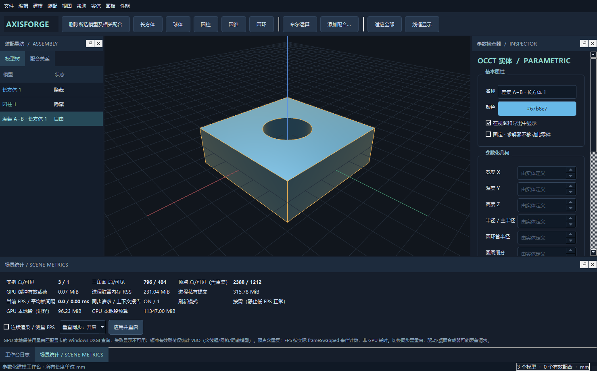
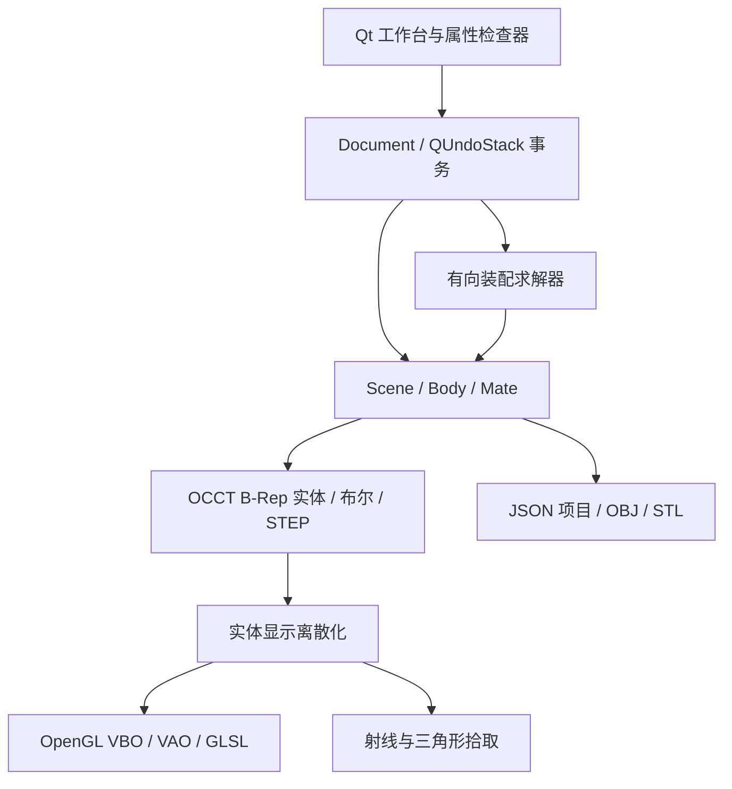

<div align="center">

# AxisForge CAD

**以参数定义形状，以约束组织装配。**

C++17 · Qt Widgets · OpenGL 3.3 Core

一个可以运行、测试和继续扩展的轻量三维 CAD 工作台。

</div>



## 项目定位

AxisForge 将参数化几何、装配约束、桌面交互与 GPU 绘制拆成独立层。创建模型后，可以修改尺寸、颜色和姿态；建立配合后，编辑基准零件会触发从动零件更新。求解失败时整次操作回滚，撤销/重做保存完整装配状态。

当前版本已接入 **Open CASCADE Technology（OCCT）实体内核**：基础图元为真实B-Rep实体，支持布尔并/差/交，以及保留主体名称、颜色和实例位置的STEP交换。OpenGL网格仅用于显示和网格导出。当前仍不包含草图约束、拉伸/旋转特征、IGES和完整特征历史。

## 已实现功能

| 领域 | 功能 |
| --- | --- |
| 参数建模 | 长方体/正方体、球体、圆柱、圆锥、圆环；可调尺寸与圆周细分 |
| 模型属性 | 名称、颜色、可见性、固定状态、位置、四元数姿态 |
| 装配 | 同轴、平行、垂直、中心距离；局部 X/Y/Z 轴作为配合基准 |
| 事务与历史 | 约束失败回滚，最多100步撤销/重做，模型复制与级联删除相关配合 |
| 三维交互 | 网格射线拾取、轨道视图、平移、缩放、适应全部、标准视图 |
| 显示 | 光照、选中边线、地面网格、坐标轴、线框、正交/透视切换 |
| 实体内核 | OCCT基础图元、拓扑校验、精确体积/面积、布尔并/差/交 |
| 文件 | 版本化 `.afcad` JSON 项目，原子保存，严格字段校验 |
| 导出 | 可见模型的 OBJ、ASCII STL，应用世界变换，单位 mm |
| 几何信息 | 解析体积、表面积与显示三角形数量 |

长方体的宽度沿 X、深度沿 Y、高度沿 Z；三者相等即为正方体。圆柱、圆锥和圆环的主轴为局部 Z。世界坐标 Z 向上。

## 快速开始

### 使用本地打包版

Windows 打包版中双击 `start.cmd`，或运行 `run/AxisForgeCAD.exe`。保持 run 目录中的 DLL、`qt.conf` 和 platforms 插件完整。源码仓库不提交 Qt 运行库和编译产物。

启动默认展示一个转轴装配：基座、主轴、定位环、球头和定位锥。主轴与定位环同轴，球头与主轴具有42 mm中心距离。

### 从源码构建

需要 CMake 3.16+、支持 C++17 的编译器、Qt 5.15 或 Qt 6 的 Widgets 开发包，OCCT 7.6或更高的7.x版本（本机7.9.3），以及支持 OpenGL 3.3 的驱动。Qt 6 还需要 OpenGLWidgets 模块。

Windows / Visual Studio 2022：

```powershell
cmake -S . -B build -G "Visual Studio 17 2022" -A x64 -DCMAKE_PREFIX_PATH="C:/Qt/6.x/msvc2022_64;C:/OCCT/opencascade-7.9.3-vc14-64"
cmake --build build --config Release --parallel 1
ctest --test-dir build -C Release --output-on-failure
```

请把 Qt 路径换成实际安装前缀；Qt 库和编译器须采用一致架构。当前本机打包环境使用 Anaconda 提供的 Qt 5.15.2 和 MSVC x64，`build.cmd` 默认指向此安装。更换Qt安装可设置 `QT_ROOT`；`OCCT_ROOT`设置为OCCT SDK前缀。本地已配置`deps/occt`开发文件，源码仓库不包含SDK。测试和运行时还需确保 Qt DLL 与平台插件可找到；标准 Qt 安装可使用对应版本的 `windeployqt` 部署。

Linux / Qt 6 的构建方式：

```bash
cmake -S . -B build -DCMAKE_BUILD_TYPE=Release
cmake --build build --parallel 2
ctest --test-dir build --output-on-failure
```

仓库提供 Linux Qt 6 CI 配置；本地验证环境与远程 CI 状态需分别看待，不能仅凭工作流文件存在就认为已通过。

## 五分钟完成一次装配

1. 用工具栏创建圆柱与圆环。
2. 选择圆柱，在右侧修改半径、高度、颜色和位置，点击“应用参数”。
3. 点击“添加配合”，圆柱为基准、圆环为从动，两者选择局部 Z 轴，配合类型选择“同轴”。
4. 改变圆柱 X/Y 位置并应用。圆环随基准移动到同一轴线上；轴向位置保留。
5. 通过配合页复选框停用或启用约束；撤销可恢复整个编辑前状态。
6. 保存为 `.afcad`，重新打开；需要交换网格时导出 OBJ/STL。

“固定”阻止求解器改变零件姿态，并非禁止用户显式编辑该零件参数。用户仍可以修改固定基准；其从动零件继续重新求解。

### 视图操作

| 操作 | 输入 |
| --- | --- |
| 选择 / 移动模型 | 左键点击 / 左键按住拖动（视图平面） |
| 删除模型 | 工具栏删除、模型树右键菜单，或在视图/模型树按 Delete |
| 打开属性面板 | 面板 → 参数检查器，或 Ctrl+I |
| 取消拖动 | Esc；一次完整拖动可用 Ctrl+Z 撤销 |
| 旋转视图 | 右键拖动 |
| 平移视图 | 中键拖动 |
| 缩放 | 滚轮 |
| 适应全部 | F |
| 等轴测/前/右/俯 | 1 / 2 / 3 / 4 |
| 创建五种图元 | Ctrl+1 ～ Ctrl+5 |
| 添加配合 | Ctrl+M |
| 保存 / 撤销 / 复制 | Ctrl+S / Ctrl+Z / Ctrl+D |

## 装配求解语义

配合是**有方向的驱动关系**：source 为基准，target 为从动。轴均由模型原点和局部轴定义，不支持直接选择任意面、边或孔作为配合特征。

| 约束 | 实际限制 | 保留的运动 |
| --- | --- | --- |
| 同轴 | 两轴方向平行、轴线重合 | 沿轴滑移、绕轴转动 |
| 平行 | 所选轴方向平行，反向也允许 | 位置不受此约束限制 |
| 垂直 | 所选轴方向正交 | 位置及部分转动仍自由 |
| 中心距离 | 两模型原点欧氏距离为指定值 | 允许满足距离的其他姿态 |

中心距离不是两个面的间距。同轴不自动贴合端面，也不锁定轴向距离。没有被约束的自由度尽量保留当前状态。

求解流程：校验 → 复制候选场景 → 拓扑排序 → 按从动节点迭代投影约束（最多64轮）→ 全局残差复查 → 成功提交。位置容差0.001 mm；角向容差为轴向量叉积/点乘残差0.0001，不是角度单位。

有向循环被明确拒绝；固定从动模型若不满足配合，则拒绝操作；多个约束无法在容差内收敛时回滚。此算法服务于层级装配，不是通用非线性自由度求解器。求解失败不一定意味着数学上绝无解，也可能是当前算法无法收敛。


## OCCT实体、布尔运算与STEP

### 操作流程

1. 创建两个模型，在属性面板设置相交位置。
2. 点击工具栏“布尔运算”，或“实体”菜单的并集、差集、交集。
3. 指定主对象A和工具对象B。差集严格为A减B，二者必须不同。
4. 默认隐藏原对象但保留它们及其配合；结果是新的独立实体，可移动、复制、再次布尔。
5. 从“文件”导出可见实体为STEP，或导入`.step/.stp`追加到场景。

“实体 → 加载通孔实体示例”可直接观察长方体减圆柱的真实通孔。`examples/occt-hole.afcad`和`examples/occt-hole.step`提供对应项目与交换文件。

### 几何语义

- 基础图元参数修改后生成新的OCCT实体；体积、表面积和实体/面/边数量来自内核。
- 布尔在世界坐标执行，结果保留A的位置/姿态参考系；多个不连接的实体可作为复合结果保留。
- 无交集、完全相减、退化结果或无效拓扑会拒绝整次操作，原场景不变。
- 布尔结果与STEP导入体是**独立B-Rep快照**。它们的图元尺寸控件只读，但仍可编辑名称、颜色、显示、位置、旋转，参与配合与后续布尔。
- 修改原A/B不会自动重建已有布尔结果；这里不是完整参数化特征历史。一次布尔或STEP导入对应一条撤销记录。

### 项目保存与STEP交换边界

`.afcad` v2对独立实体内嵌压缩B-Rep，不依赖原STEP文件；单实体解压上限16 MiB。图元仍保存参数，因此旧v1项目可直接读取。STEP不保存AxisForge的配合关系、撤销栈或建模历史，完整项目请用`.afcad`。

STEP通过XDE接口交换主体级名称和单一颜色，导出所有可见实体并应用世界变换。输入装配递归展开成独立实例，组合父子位置并归一化为mm，保留零件的最终空间位置；不保留可编辑的装配层级、面级多色、PMI或外部引用文件。导入时将模型原点重定位到体积中心，局部轴对齐世界坐标，方便后续拖动和旋转。

当前只接受有效闭合实体或由实体构成的复合体；不把开放曲面或线框悄悄转换成实体。输入中遇到无效零件会拒绝整次导入。STEP输入上限64 MiB、最多300个展开实例、层级最多64，每体最多20000个面、显示网格最多100万个三角形。这些是资源边界，不是任意复杂文件的性能保证。

Linux构建依赖可安装：`libocct-data-exchange-dev libocct-modeling-algorithms-dev libocct-modeling-data-dev libocct-visualization-dev libocct-ocaf-dev`。CMake自动适配7.6的TKXDESTEP与7.9的TKDESTEP工具包布局。

官方依赖：[OCCT 7.9.3发布包](https://github.com/Open-Cascade-SAS/OCCT/releases/tag/V7_9_3)。Windows运行包包含所需动态库、STEP资源及许可说明；SDK、源码和运行包分开管理。

## 架构



| 模块 | 职责 |
| --- | --- |
| `src/core/Scene.*` | 数据模型、参数校验、解析体积与面积 |
| `src/core/Geometry.*` | OCCT网格缓存、包围盒、拾取 |
| `src/core/Kernel.*` | 实体构造、拓扑校验、精确几何量、布尔运算、B-Rep持久化 |
| `src/core/StepIO.cpp` | STEP/XDE名称颜色交换、装配实例展开、单位转换 |
| `src/core/Constraints.*` | 约束残差、依赖排序、迭代求解与回滚 |
| `src/core/ProjectIO.*` | 严格 JSON 解析、原子保存、网格导出 |
| `src/app/Document.*` | 编辑事务、快照历史、复制和级联删除 |
| `src/render/Viewport.*` | GPU 资源、光照、选择显示、相机 |
| `src/ui/MainWindow.*` | 操作入口、模型树、属性与配合面板 |
| `tests/core_tests.cpp` | 不依赖 OpenGL 上下文的核心回归测试 |

核心只依赖 Qt Core/Gui 数学与容器功能，不依赖窗口或 OpenGL 上下文。渲染资源仅在有效当前上下文内创建和释放。显示网格在文档变化后重建，相机操作不会每帧重新生成网格。

## 项目文件与数据边界

`.afcad` 是 UTF-8 JSON，包含 `format`、`version`、`units`、模型与约束列表。旋转以 `[w,x,y,z]` 四元数保存，颜色使用 RGB 十六进制字符串。文件不包含机器绝对路径或外部执行指令。

- schema version：2（兼容读取version 1图元项目）；长度单位：mm。
- 单文件最大64 MiB，最多300个模型、1000个约束。
- 尺寸0.1～10000 mm，位置各分量绝对值不超过1000000 mm。
- 细分8～128，圆环管半径小于主半径。
- 拒绝重复 ID、无效引用、非有限数值、错误字段类型、不支持的版本和单位。
- 加载先在候选场景校验并求解；失败不覆盖当前项目。
- 保存使用 QSaveFile，验证失败不覆盖原文件。

数量上限用于输入校验，不代表在上限规模保证交互帧率。当前拾取逐三角形计算，尚未建立 BVH；参数编辑会重建场景缓存，大场景可继续优化。

OBJ 输出不包含 MTL 材质和颜色；STL 不包含颜色、参数和配合信息。两者均仅输出可见模型，且不执行实体合并或接触修复。用于制造前应由专门工具检查网格与工艺适用性。

## 测试与复现

```powershell
ctest --test-dir build -C Release --output-on-failure
build/Release/AxisForgeCAD.exe --self-test build/test-artifacts
```

核心测试覆盖五种网格的法线、绕序、非退化三角形与近似体积，变换后拾取，四种配合、链式传播、循环、冲突、固定模型、禁用配合，文件往返、错误输入与导出。

桌面自检会实际创建 OpenGL 3.3 上下文，执行创建动作、属性修改、装配传播、撤销/重做、保存重载、导出、拾取和鼠标选择，最终读取 GPU 帧缓冲，生成 `desktop-test.json` 与工作台截图。

自检不能代替全部人工交互验证：任意规模装配、复杂多约束收敛、多显示器高 DPI、不同驱动与长时间压力测试均不在本次保证范围内。具体执行结果与环境见 [测试报告](docs/TESTING.md)。

## 扩展路线

1. 增加命名坐标系、面/边/孔配合基准及求解残差可视化。
2. 引入 BVH 拾取、局部网格缓存和增量重建。
3. 增加草图、拉伸、旋转特征与可编辑特征历史。
4. 扩展面/边级选择、IGES交换及更丰富的曲面建模。
5. 增加通用约束求解、自由度诊断、碰撞检测与装配动画。

这些属于后续方向，不是当前已经实现的功能。

## 开发与贡献

新增图元应同时提供：参数校验、解析几何属性、离散网格、法线与绕序测试、属性面板支持。新增约束应明确基准定义、保留自由度、残差单位、失败条件，并增加传播和回滚测试。保持 core 不依赖 UI；不要在属性回调中直接执行 OpenGL 资源操作。

## 许可

原创项目源码采用 [MIT License](LICENSE)。Qt 及其他运行时组件遵循各自许可；源码仓库不重新许可这些组件。

### 模型拖动与约束

拖动在经过模型原点的视图平面内进行，右侧坐标实时更新。松开鼠标后只产生一条撤销记录；Esc 回到拖动前状态。固定模型不能直接拖动，先在属性检查器取消固定。受配合限制的自由度会由求解器投影回允许范围，因此拖动从动零件不一定能沿所有方向移动。

## 场景统计与性能观察

通过“性能 → 场景统计”或 Ctrl+Shift+I 打开；面板关闭后可重新打开，每500 ms刷新。

- 实例总数/可见数；三角面总数/可见数；顶点总数/可见数（含重复顶点，不是去重几何顶点）。几何计数来自最近上传的图元网格，不包含网格线、选择边线等辅助图元。
- GPU缓冲有效载荷：实际上传VBO的数据字节数，包含三角形、线框、地面网格和隐藏模型缓存；不包含帧缓冲和驱动开销。
- Windows下通过匹配OpenGL渲染器名称的DXGI适配器查询本进程GPU本地段使用量及OS预算。无法匹配或接口不可用时显示不可用；不把其他显卡或整机显存误作当前进程占用。集成显卡的本地段不一定是独立显存。
- 进程RSS与Windows私有提交量分别显示；Linux读取/proc/self/statm的RSS，不支持的统计显示不可用。
- FPS按QOpenGLWidget的frameSwapped事件计算，平均帧间隔由1000/FPS换算，不是GPU执行时间。按需模式下静止画面FPS低属于正常现象。

比较开/关垂直同步：勾选“连续渲染 / 测量FPS”，等待刷新，记录当前值；切换同步模式并点击“应用并重启”，在同一项目、相机和窗口大小下再次开启连续渲染比较。重启前会处理未保存修改。也可通过 `--vsync=1` 或 `--vsync=0` 启动。同步请求与上下文报告分列展示，驱动/桌面合成器可能忽略或覆盖请求，不能把请求值当作硬件生效证明。短时自检样本用于验证计数链路，不作为正式性能基准。

## 四种显示模式

工具栏下拉框或“视图 → 显示模式”可切换，也可按Alt+1～4。显示模式是视图设置，不修改模型、不进入撤销历史。

| 模式 | 快捷键 | 绘制内容 |
| --- | --- | --- |
| 常规 | Alt+1 | 光照着色实体，选中时高亮拓扑边 |
| 三角面 | Alt+2 | 着色表面叠加三角剖分边，观察显示网格密度 |
| 包围盒 | Alt+3 | 只显示模型局部坐标系下的包围盒，随模型位置和旋转一起变换 |
| 线框 | Alt+4 | 只显示OCCT真实拓扑边，包含曲线采样；不显示三角剖分内部边 |

包围盒由OCCT几何计算，不用粗网格的极值近似。包围盒模式下可点击盒内区域选择/拖动模型；其他模式仍按实体显示网格拾取，线条不是额外的独立可编辑对象。隐藏模型不显示，也不能被拾取。

为了切换时不重建几何，三角边和包围盒线段与其他显示数据一起缓存。显存缓冲统计包含这些辅助数据；三角面数与顶点数只统计实体表面网格。重复切换模式不会持续增加缓冲分配。
