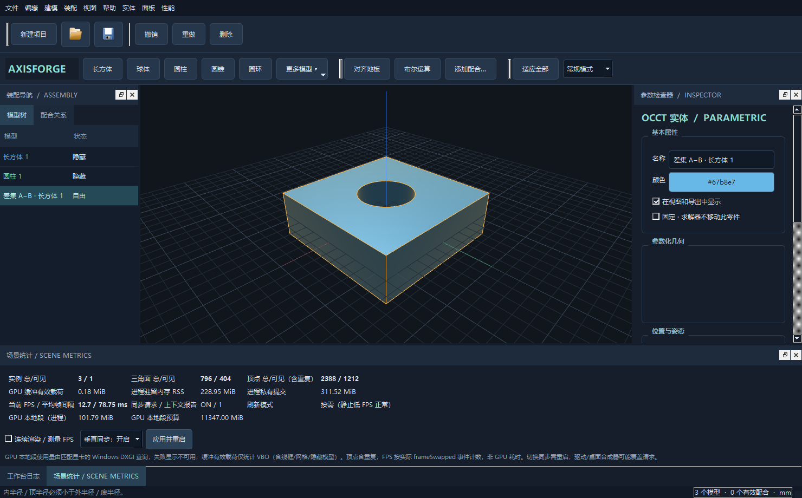

# AxisForge CAD 1.0.0：项目详解与 Qt 实战学习手册

**从一个按钮开始，读懂一套 Qt + OpenGL + OCCT 三维桌面软件。**

文档日期：2026-11-16。语言：C++17。项目版本：1.0.0。源码基线：`59a0bc65b0bb12b9633184b80eda0466022492f2`。

[项目仓库](https://github.com/13536309143/AxisForge-CAD) · [对应源码](https://github.com/13536309143/AxisForge-CAD/tree/59a0bc65b0bb12b9633184b80eda0466022492f2) · [正式版下载](https://github.com/13536309143/AxisForge-CAD/releases/tag/v1.0.0)

这份手册以“学习 Qt”为主线，解释项目为什么这样组织、一次操作如何从界面传到模型、模型如何出现在屏幕上。你不必先学完 OpenGL 或 OCCT，才能开始学习 Qt。建议先读第 1—16 章，完成配套 QtWidgetsLab，再进入文档事务与三维显示。

“项目实现”指上述固定提交；“教学示意”是为讲解机制而简化的片段；“扩展建议”是尚未实现的方向。除配套练习工程外，零散代码片段通常需要放进对应类和上下文，不能当作完整程序直接编译。文中的 `src/...` 是相对项目根目录的源码路径。本机项目位于 `E:\QT\AxisForge-CAD`。

**阅读导航：** [项目与环境](#chapter-1) · [Qt 基础](#chapter-6) · [纯 Qt 练习](#chapter-16) · [文档与撤销](#chapter-17) · [Qt/OpenGL](#chapter-20) · [几何与交换](#chapter-26) · [调试与学习路线](#chapter-31) · [三角形练习](#chapter-39) · [源码精读](#chapter-40)



<a id="chapter-1"></a>

## 1. 你将通过这个项目学会什么

### 1.1 学习目标

学完第一轮，应能独立写出带菜单、工具栏、属性面板和文件保存的 Qt 程序。学完第二轮，应能解释模型创建、属性修改、拖动和撤销的完整数据流。学完第三轮，应能把自己的 OpenGL 控件放入 Qt 窗口，并知道上下文、缓冲、着色器、矩阵和鼠标拾取分别做什么。

判断是否学会，不在于记住所有类名，而在于能回答具体问题：为什么属性面板关闭后还可以打开？为什么输入框变了，模型还没变？为什么一个拖动只撤销一次？为什么导入 OBJ 后不能做实体布尔？为什么调用 `update()` 后不是立刻进入绘制？

### 1.2 最低 C++ 基础

需要理解类、继承、构造与析构、指针与引用、`const`、枚举、容器和 lambda。遇到以下语法可以先按这张表阅读：

| 写法 | 在本项目里的含义 |
| --- | --- |
| `class MainWindow : public QMainWindow` | 自定义一种主窗口 |
| `Viewport *viewport_` | 保存视口对象的地址 |
| `const Scene &scene()` | 只读访问现有场景，避免复制 |
| `[this] { refresh(); }` | 一个能访问当前对象的回调 |
| `override` | 明确重写基类虚函数，签名错误会报错 |
| `std::unique_ptr<T>` | 由一个持有者管理的资源 |
| `std::shared_ptr<const SolidData>` | 可共享、通过此指针不可修改的几何数据 |
| `parameters.*field.member` | 按“成员指针”访问指定参数字段 |

先把 Qt 基础练习跑通，再回头学习成员指针和复杂几何模板。不要让 OCCT 的类型名挡住 Qt 入门。

<a id="chapter-2"></a>

## 2. 项目功能与技术分工

### 2.1 当前能做什么

| 方向 | 1.0.0 已实现 | 要理解的边界 |
| --- | --- | --- |
| 参数建模 | 长方体、球、圆柱、圆锥、圆环、圆管、圆台、椭球、楔体 | 不是从任意草图生成实体 |
| 属性 | 名称、尺寸、颜色、位置、旋转、可见、固定 | 导入实体和布尔结果的几何不再由基本图元参数定义 |
| 编辑 | 选择、删除、复制、拖动、撤销、重做 | 会话撤销记录不写入项目文件 |
| 布尔 | OCCT 实体并集、差集、交集 | 结果是独立快照，没有参数特征依赖树 |
| 配合 | 同轴、平行、垂直、中心距离、原点重合、指定夹角、沿轴偏移、地面配合 | 依赖对象原点和局部轴；不提供任意面／边基准选择 |
| 显示 | 常规、三角面、包围盒、拓扑线框；正交／透视 | 不是完整工程制图与消隐线输出 |
| 文件 | 项目、STEP、GLB、OBJ；ASCII STL 导出 | 网格不自动变成有效 B-Rep 实体 |
| 统计 | 实例、顶点、三角形、自有缓冲、进程内存、FPS、同步状态 | 自有缓冲字节不等于 GPU 总显存 |

没有草图约束求解器、完整特征树、任意曲面编辑、IGES 交换和通用闭环工业装配求解。阅读设计时，应区分“适合作为扩展基础”和“已经具备完整工业能力”。

### 2.2 Qt、OpenGL、OCCT 分别负责什么

Qt 负责桌面软件的外壳和交互机制：窗口、控件、布局、键鼠事件、信号槽、文件对话框、定时器、撤销框架。OpenGL 负责把顶点数据画成实时图像。OCCT 负责实体的几何、拓扑、布尔运算、属性和 STEP 交换。

```text
用户点击“创建圆柱”
  ↓ Qt QAction / 参数对话框
Document 接收一次编辑请求
  ↓ 校验、配合求解、撤销命令
Scene 保存 Body 与 Mate
  ↓ OCCT 生成 B-Rep，并离散为显示网格
Viewport 通过 QOpenGLWidget 获得图形上下文
  ↓ 上传 VBO，绑定 VAO，设置着色器与矩阵
OpenGL 绘制 → Qt 合成 → 屏幕
```

同一个球有三种表达：`Body` 中的业务对象、OCCT 中的解析实体、GPU 中的三角形。对象名称不会自动进入 GLSL；三角形也不会自动知道自己是球。项目代码负责在它们之间建立联系。

<a id="chapter-3"></a>

## 3. 先操作一次，再读源码

启动完整运行包的 `start.cmd`。中央是三维视口，左侧组织模型和配合，右侧编辑属性，底部显示日志和统计。长度使用 mm，Z 轴向上，地面固定在世界坐标 `Z=0`。

依次完成以下操作：

1. 创建长方体，设长度 80、宽度 50、高度 20，名称“底座”。
2. 选中它，添加地面配合；底部应到达 Z=0，而不是把地板移动到模型下方。
3. 创建圆柱，半径 8、高度 40，通过属性使其穿过底座。
4. 做差集，确认运算顺序为“底座减圆柱”；查看通孔结果。
5. 切换三角面和线框，比较三角形对角线与实体拓扑边。
6. 删除结果、撤销删除；拖动对象、撤销拖动。
7. 关闭属性面板，从视图／面板入口重新打开，也可尝试 `Ctrl+I`。
8. 保存 `.afcad`，关闭后重开；导出 STEP 与 GLB，观察它们保存的内容差异。

右键拖动旋转相机，中键拖动平移，滚轮缩放。左键选择／拖动模型；`Esc` 取消正在进行的拖动；`Delete` 删除选中模型。固定对象或受配合驱动的对象不一定能按鼠标方向自由移动，这是模型规则的结果。

<a id="chapter-4"></a>

## 4. 环境安装与完整构建

### 4.1 学 Qt 时先分两种环境

**配套入门练习**只需 C++ 编译器、CMake 和 Qt Widgets，不需要 OCCT。**CAD 主工程**还需要匹配编译器和位数的 OCCT、第三方库及 OpenGL 3.3 Core 图形环境。把两者分开，可以先验证 Qt 安装没有问题。

正式 Windows 包使用 Qt 6.8.3、MSVC 2022 x64、OCCT 7.9.3。本机另验证了 Qt 5.15.2 的兼容构建。Qt Creator 是开发环境；Qt 库是程序依赖；MSVC 是编译工具；CMake 描述怎样构建，四者不是同一个东西。

### 4.2 Windows 主工程

安装 Visual Studio 2022 的“使用 C++ 的桌面开发”，以及 Qt 的 `msvc2022_64` 组件。在 Developer PowerShell 中执行以下示例，Qt 路径改成自己的实际位置：

```powershell
git clone https://github.com/13536309143/AxisForge-CAD.git
Set-Location AxisForge-CAD
git checkout 59a0bc65b0bb12b9633184b80eda0466022492f2
$env:QT_ROOT_DIR = 'C:\Qt\6.8.3\msvc2022_64'
.\scripts\setup-occt.ps1
.\scripts\package-windows.ps1
```

固定提交可复现本文，进入 detached HEAD 是正常现象。若要做练习修改，先 `git switch -c learning/qt` 创建自己的分支。

安装脚本下载并检查 OCCT SDK，打包脚本配置 CMake、编译、收集 DLL、调用 `windeployqt`、复制资源及许可、运行核心测试并生成 ZIP。它们不会替你安装 Qt 开发包。下载的 Windows 运行包包含运行依赖，但不包含 Qt／OCCT 开发 SDK。

手动构建时，前缀指向开发 SDK，不是仅含 DLL 的运行目录：

```powershell
$qt = 'C:\Qt\6.8.3\msvc2022_64'
$occ = 'C:\SDK\opencascade-7.9.3-vc14-64'
cmake -S . -B build -G 'Visual Studio 17 2022' -A x64 "-DCMAKE_PREFIX_PATH=$qt;$occ"
cmake --build build --config Release --parallel 2
ctest --test-dir build -C Release --output-on-failure
```

最后一步需要先配置 DLL、Qt 平台插件与 OCCT 资源的运行环境；纯编译成功不表示运行环境已齐全。详细部署步骤见项目 README。

### 4.3 Qt Creator 与 Linux

Qt Creator 打开根目录 `CMakeLists.txt`，选与 SDK 一致的 Kit，在 CMake 配置中指定 Qt／OCCT 前缀，再配置运行环境。不要把一个用 MinGW 构建的 Qt 库交给 MSVC 链接；Qt5 和 Qt6 的生成目录也应分开。

Ubuntu 24.04 可按 README 安装 Qt6、`libqt6opengl6-dev`、OCCT 建模与交换开发包，以及 Ninja、Mesa、Xvfb 等依赖。配置 `-DCMAKE_BUILD_TYPE=Release` 后编译；无显示器测试使用 `LIBGL_ALWAYS_SOFTWARE=1 xvfb-run -a ctest --test-dir build --output-on-failure`。软件渲染测试可以检验功能，不能代表本机显卡性能。

<a id="chapter-5"></a>

## 5. 源码地图：先看哪些文件

| 文件 | 主要问题 | 初读重点 |
| --- | --- | --- |
| `src/main.cpp` | 程序如何启动 | 格式设置、QApplication、show、exec |
| `src/ui/MainWindow.h/.cpp` | 窗口如何组织 | 构造函数、buildActions、buildPanels、refresh |
| `src/ui/CreateBodyDialog.cpp` | 各图元如何显示不同参数 | 表单循环、确认／取消、错误提示 |
| `src/ui/MateEditor.cpp` | 配合如何编辑和预览 | 选择、临时状态、提交 |
| `src/app/Document.h/.cpp` | 编辑如何变得可撤销 | edit、SnapshotCommand、拖动三阶段 |
| `src/core/Scene.h/.cpp` | 保存什么数据 | Body、Mate、Parameters、validate |
| `src/core/ParameterFields.h` | 参数表单从哪来 | 字段元数据与成员指针 |
| `src/render/Viewport.h/.cpp` | Qt 如何承载三维画面 | initializeGL、paintGL、事件与信号 |
| `src/render/MateOverlay.cpp` | 如何绘制配合说明 | QPainter、投影、标注 |
| `src/core/Geometry.*` | 网格和拾取 | Vertex、Bounds、射线 |
| `src/core/Kernel.*` | 实体从哪来 | solidData、createSolid、booleanBody |
| `src/core/Constraints.*` | 配合如何满足 | residual、solve |
| `src/core/Presentation.*` | 地板与辅助几何 | adaptiveGrid、mateGuide |
| `src/core/ProjectIO.*` | 项目如何保存 | JSON、版本、QSaveFile |
| `src/core/StepIO.cpp`、`MeshIO.cpp` | 交换什么几何信息 | STEP／GLB／OBJ |
| `tests/core_tests.cpp`、`src/ui/*checks.inc` | 如何验证功能 | 前置条件、操作、结果 |

第一次阅读可以跳过 `MainWindow.cpp` 后半部分的自检代码。不要看到一个文件很长，就从第一行一直硬读到底；先从具体功能追踪到被调用的函数。

<a id="chapter-6"></a>

## 6. Qt 是什么：从类体系开始

### 6.1 QObject、QWidget、QMainWindow

`QObject` 提供对象关系、信号槽、属性和事件等基础机制。`QWidget` 在此基础上提供可见控件、尺寸、绘制和输入处理。`QMainWindow` 是面向桌面应用的窗口框架，提供中央区域、菜单、工具栏、停靠面板和状态栏。

在本项目中，`MainWindow` 是主窗口，`Viewport` 是一种特殊控件；`Document` 继承 QObject，可以发信号，但它不是可见控件。`Scene` 是普通 C++ 数据结构，负责保存场景内容，不需要继承 QWidget。

可以用下面的关系帮助记忆：

```text
QObject
├─ Document：管理文档，不显示
└─ QWidget
   ├─ QMainWindow → MainWindow：工作台框架
   ├─ QDialog：参数与配合窗口
   ├─ QPushButton / QLabel / QTreeWidget：普通控件
   └─ QOpenGLWidget → Viewport：三维画面
```

### 6.2 Q_OBJECT 与 moc

`MainWindow`、`Document`、`Viewport` 声明 `Q_OBJECT`，使自定义信号等元对象功能可用。`moc` 生成相应元对象代码，CMake 的 `CMAKE_AUTOMOC ON` 帮忙把这一步加入构建。它不取代 C++ 编译器，也不会把普通类自动变成控件。

本项目许多接收函数是普通成员函数，没有写在 `slots:` 下。使用函数指针形式的 `connect` 时，这完全可以。自定义信号声明在 `signals:` 下，由 moc 提供实现，不要自己再写一份信号函数体。有关机制可查 [Qt 元对象与信号槽](https://doc.qt.io/qt-6.8/signalsandslots.html)。

### 6.3 QString、容器和数学类型

`QString` 保存 Unicode 文本；`QStringLiteral` 适合源码中的固定文本。`QVector` 保存对象序列；`QMap` 按键查找输入控件；`QVector3D`、`QQuaternion`、`QMatrix4x4` 支持三维计算。UI 与业务暂时共用这些 Qt 类型，是项目的实际设计，核心层并非完全不依赖 Qt；它只是不依赖可见的 Widgets 界面。

<a id="chapter-7"></a>

## 7. main：程序怎样真正运行起来

`main.cpp` 先读垂直同步偏好与命令行，再请求 OpenGL 3.3 Core、24 位深度缓冲和 4 倍采样。随后创建 QApplication、设置应用信息、创建 MainWindow 并显示，最后进入 `app.exec()`。

```cpp
// 教学示意：保留最关键的启动顺序
QSurfaceFormat format;
format.setVersion(3, 3);
format.setProfile(QSurfaceFormat::CoreProfile);
format.setDepthBufferSize(24);
QSurfaceFormat::setDefaultFormat(format);

QApplication app(argc, argv);
af::MainWindow window;
window.show();
return app.exec();
```

`show()` 请求显示窗口。`exec()` 启动事件循环，持续接收窗口系统事件、计时器、重绘和队列中的调用。没有事件循环，窗口通常来不及正常响应就结束了。`exec()` 并不意味着让你的某个模型计算函数反复执行。

Qt 的绘制与输入依赖事件循环，因此 GUI 线程里长时间运行布尔或导入操作会延迟界面响应。`QTimer` 只是定时安排任务，并不会把任务自动移到后台线程。当前工程有同步的建模与交换路径；后台任务是后续可扩展的方向。

**练习：**在 MainWindow 构造函数和按钮回调各加一条 `qDebug()`，观察构造只发生在启动时，按钮回调在点击时执行。不要在构造函数写无限循环“等待用户点击”。

<a id="chapter-8"></a>

## 8. 对象生命周期：new 出来的控件谁来释放

### 8.1 父子对象树

Qt 会在父 QObject 析构时删除其子对象。例如 `new QPushButton("创建", page)` 把按钮交给 `page` 管理。将控件加入已安装的布局时，也会建立相应的控件归属关系。布局管理位置和尺寸；QObject 父子关系承担对象生命周期，两者有联系但概念不同。

主窗口里的 `Document document_` 是 C++ 成员。它在构造列表中使用 `document_(this)`，同时加入 QObject 树；成员先于 QObject 基类析构并从父对象移除，不需要再对 `&document_` 执行 delete。

不要把所有指针都机械改成 `unique_ptr`；当一个 QWidget 已由父对象拥有时，再引入互相矛盾的销毁责任会增加风险。要明确每个对象由谁拥有。参考 [Qt 对象树与所有权](https://doc.qt.io/qt-6.8/objecttrees.html)。

### 8.2 栈上的对话框为什么能工作

创建模型使用 `QDialog dialog(this)`，局部变量离开作用域时析构。对话框的子控件随之释放。它调用 `dialog.exec()` 后进入局部事件循环，函数暂时不返回，用户仍能与对话框交互；关闭后函数继续运行。

项目中的 `[&]` 回调引用了这次函数调用里的参数与控件指针，成立的前提是它们在回调运行期间仍存活。若改成非模态 `show()` 后立即返回，原先的栈对象和引用捕获就不能照搬。非模态长寿命窗口应重新设计所有权和捕获方式。

`QPointer<QDialog>` 用于追踪可能被销毁的 QObject，目标销毁后指针会自动变空。它不拥有对象，也不是通用智能指针。项目用它保存配合编辑器，避免保留悬空窗口指针。

<a id="chapter-9"></a>

## 9. 窗口与布局：把界面组织清楚

### 9.1 QMainWindow 的正确入口

项目创建 `viewport_` 后调用 `setCentralWidget(viewport_)`。菜单经 `menuBar()`，状态栏经 `statusBar()`，工具栏经 `addToolBar()`，停靠面板经 `addDockWidget()` 接入。QMainWindow 已有管理这些区域的内部布局，不应像普通 QWidget 一样直接塞入自己的顶层 QVBoxLayout。

普通页面可以这样写：

```cpp
// 教学示意：一页“名称 + 提交按钮”
auto *page = new QWidget;
auto *layout = new QVBoxLayout(page);
auto *form = new QFormLayout;
auto *name = new QLineEdit;
form->addRow(QStringLiteral("名称"), name);
layout->addLayout(form);
layout->addWidget(new QPushButton(QStringLiteral("应用")));
```

### 9.2 该选哪种布局

| 布局／容器 | 适合情况 | 项目里的用途 |
| --- | --- | --- |
| QVBoxLayout | 从上到下 | 参数标题、表单、提示、按钮 |
| QHBoxLayout | 从左到右 | 一排控制按钮 |
| QFormLayout | 标签与字段成对 | 尺寸和位姿编辑 |
| QGridLayout | 多行多列 | 可用于规则仪表面板，当前不必强行替换 |
| QScrollArea | 内容超过可用高度 | 属性页面 |
| QTabWidget | 分类切页 | 模型与配合等工作内容 |
| QSplitter | 用户调整区域比例 | 可调整的分区 |

布局计算会受 `minimumSize`、`sizeHint`、`sizePolicy` 和 stretch 影响。优先用布局表达关系，少用一组写死的 `move()`、`resize()`。项目主窗口的最小尺寸是设计选择，不代表每个练习都要照搬为 1100×720。

**练习：**把 QtWidgetsLab 窗口拖窄，观察表单、文本和按钮的位置；再添加 `layout->addStretch()`，解释空白为什么改变。

<a id="chapter-10"></a>

## 10. QAction 与 QDockWidget：桌面软件的组织方式

### 10.1 一个操作对应一个动作

`QAction` 表示“保存”“删除”“三角面模式”等操作，可以同时出现在菜单、工具栏和快捷键入口。其状态包括文本、可用、选中和快捷键。这样业务入口集中，避免三个按钮分别写出不一致的删除行为。

```cpp
// 教学示意：同一个保存动作供两个入口共用
auto *save = new QAction(QStringLiteral("保存"), this);
save->setShortcut(QKeySequence::Save);
fileMenu->addAction(save);
toolbar->addAction(save);
connect(save, &QAction::triggered, this, [this] { /* 保存当前文档 */ });
```

互斥的显示模式适合由 QActionGroup 管理；项目还同步组合框和视口显示状态。编写同步代码时，要避免 UI 更新触发另一个 UI，再无限回调。

### 10.2 面板关闭后为什么还能打开

属性面板是 QDockWidget。关闭通常使它隐藏，不应把“隐藏”误当成“彻底销毁”。项目将 `propertyDock->toggleViewAction()` 放入菜单，并设置 `Ctrl+I`，用户可再次显示面板。场景统计的对应快捷键是 `Ctrl+Shift+I`。

```cpp
// 教学示意：面板与菜单的重新打开入口
auto *dock = new QDockWidget(QStringLiteral("属性"), this);
dock->setObjectName("propertiesDock");
dock->setWidget(new QLabel(QStringLiteral("请选择模型")));
addDockWidget(Qt::RightDockWidgetArea, dock);
viewMenu->addAction(dock->toggleViewAction());
```

`objectName` 是程序识别对象的名称，便于 `findChild`、测试以及可能的布局恢复；窗口标题是给用户看的，两者不要混淆。扩展 `saveState/restoreState` 时应为相关面板设置稳定且唯一的对象名；本文不把布局持久化当成已完整实现的功能。

<a id="chapter-11"></a>

## 11. 信号槽：把对象连接起来

### 11.1 先理解一条连接

```cpp
connect(&document_, &Document::changed,
        this, &MainWindow::refresh);
```

第一个参数是发出信号的对象，第二个是信号，第三个是接收对象，第四个是处理函数。其含义是“文档变化时刷新主窗口”。不是连接时马上调用一次 refresh，也不需要在 while 循环里检查文档有没有变。

项目中的信号链包括：

```text
Viewport::selected(id) → MainWindow::selectBody(id)
Viewport::moveStarted(id) → Document::beginMove(id)
Viewport::movePreview(id, position) → Document::previewMove(...)
Viewport::moveFinished(commit) → Document::finishMove(commit)
Document::changed() → MainWindow::refresh()
Document::rejected(reason) → 状态栏 + 日志
```

### 11.2 lambda、参数与生命周期

连接到 lambda 可以附加少量逻辑。推荐带接收上下文的写法，让 Qt 能在上下文销毁后断开关联：

```cpp
connect(button, &QPushButton::clicked, this, [this] {
    statusBar()->showMessage(QStringLiteral("按钮被点击"), 3000);
});
```

`[this]` 捕获当前对象地址，不是复制整个窗口。不要捕获已经离开作用域的局部变量引用。函数指针形式会检查很多签名问题；有重载的信号可能需要 `QOverload<int>::of(...)` 或显式转换，项目的组合框连接就是例子。

### 11.3 emit 不等于启动线程

同线程自动连接通常直接调用接收函数，因此 `emit changed()` 可能在返回之前就完成 refresh。跨线程自动连接可能成为队列调用，需要目标线程事件循环。信号槽提供通信机制，不保证回调在后台执行。相关规则见 [Qt Signals & Slots](https://doc.qt.io/qt-6.8/signalsandslots.html)。

<a id="chapter-12"></a>

## 12. 属性面板与数据同步：界面不是数据本身

项目真实数据位于 `Document` 内的 `Scene`，输入框只是当前选中对象的展示和待提交值。不能把所有模型的尺寸都只保存在一个 QDoubleSpinBox 里，否则切换选择时就会失去其他对象的数据。

`selectBody(id)` 更新选择；`showProperties()` 从对象读取名称、颜色、参数、位置和旋转；用户编辑后，`applyProperties()` 组装更新值，通过文档事务提交。选择、相机和显示模式属于交互／展示状态，不必每次都进入模型撤销历史。

### 12.1 为什么需要 refreshing_

刷新树控件时，`clear`、`setCurrentItem` 和 `setCheckState` 可能触发选择或修改信号。若回调把这些变化当作用户操作，就会递归修改文档。项目以 `refreshing_` 标记程序正在回填 UI，相关回调先检查此标志。

其他常见做法包括 `QSignalBlocker` 暂时屏蔽某个对象信号，或把模型与视图逻辑进一步分开。不要在窗口构造时再建一份 Scene 给属性面板维护；否则两份数据迟早不一致。

### 12.2 ID 为什么比名称可靠

模型树通过 `item->setData(0, Qt::UserRole, b.id)` 保存对象 ID，显示文本则是 `b.name`。名称允许修改甚至重复；ID 用来建立稳定引用。删除、选择、配合和 GPU 对象关联都依赖 ID。项目刷新后按 ID 找回选择，不把树中的行号当永久身份。

### 12.3 QTreeWidget 与 Model/View

QTreeWidget 提供现成 item 容器，适合当前体量和学习阶段。更大项目可用 QTreeView + QAbstractItemModel，实现精确的行更新、排序和延迟加载。那是结构升级建议；当前项目刷新会重建树，不能宣称已经具有大型装配的增量树更新。

<a id="chapter-13"></a>

## 13. 参数对话框：一个适合精读的 Qt 文件

推荐逐行阅读 `src/ui/CreateBodyDialog.cpp`。它集中展示局部对话框、布局、输入范围、动态表单、信号槽、用户反馈和确认／取消，是比直接阅读全部三维代码更好的 Qt 入门点。

### 13.1 参数为什么随模型类型变化

`parameterFields(shape)` 返回字段列表，每项有 key、中文标签以及 `Parameters` 的成员指针。对话框按列表创建 QDoubleSpinBox，不为每种图元复制一套完整窗口。

```cpp
// 项目结构摘录：指向 Parameters 中一个 double 成员
struct ParameterField {
    QString key, label;
    double Parameters::*member;
};
// field.member 可能是 &Parameters::radius
// 读取：parameters.*(field.member)
```

此设计不是反射引擎，而是一张手工维护的元数据表。新增字段时还要检查参数结构、校验、内核构造、保存格式与测试，不能只在对话框多放一个输入框。

| 图元 | 创建参数 |
| --- | --- |
| 长方体／楔体 | X 长度、Y 宽度、Z 高度 |
| 球 | 半径、曲面细分 |
| 圆柱／圆锥 | 半径或底半径、高度、曲面细分 |
| 圆环 | 主半径、次半径、曲面细分 |
| 圆管 | 外半径、内半径、高度、曲面细分 |
| 圆台 | 底半径、顶半径、高度、曲面细分 |
| 椭球 | X、Y、Z 方向直径、曲面细分 |

### 13.2 确认与取消的真实流程

对话框把长度范围设为 0.1—10000 mm、小数三位；有细分的模型使用 8—128。确认时检查名称，读取参数，调用 `Document::addBody`；如果失败，显示原因并保持窗口打开；成功才选择新对象、适配视图并 `accept()`。取消直接 `reject()`，不先创建一个模型再试图删除。

输入框范围只能检查局部数值。圆环次半径小于主半径、圆管内半径小于外半径等关系，仍须由业务校验保证。程序文件导入和未来脚本入口也可能绕过 UI，因此只靠控件范围不够。

**练习：**把“名称为空”时的提示改成显示在确认按钮上方，尝试圆管内半径大于外半径，解释为什么失败后场景和撤销栈没有多一个对象。

<a id="chapter-14"></a>

## 14. 事件、焦点与快捷键

### 14.1 事件和信号的区别

鼠标、键盘、窗口关闭等由 Qt 事件系统派发，对应 `mousePressEvent`、`keyPressEvent`、`closeEvent`。按钮内部处理鼠标事件后，发出更易使用的 `clicked` 信号。通常使用按钮信号；需要自定义三维交互时才重写底层事件。

Viewport 使用 `Qt::StrongFocus`，鼠标按下时 `setFocus()`，因此能收到 Delete 与 Esc。一个 QWidget 存在，不代表它始终能收到键盘输入；当前焦点可能在属性输入框中。

### 14.2 为什么输入框按 Delete 不应删除模型

项目对树安装事件过滤器，并在相关处理处区分上下文。事件过滤器可在目标对象正常处理前观察事件：返回 true 表示拦截；没有处理时应交回基类／正常流程。不要给整个应用绑定一个不分焦点的删除快捷键，否则用户编辑名称时会误删对象。

### 14.3 closeEvent 与未保存修改

主窗口关闭时通过 `mayDiscard()` 检查是否有未保存更改，允许用户保存、放弃或取消。取消就 `ignore()` 关闭事件；同意才继续关闭。与之对应，文件打开和同步模式重启也要考虑当前文档状态，而不是直接丢弃编辑。

**练习：**分别把焦点放到视口、模型树、名称框，按 Delete；记录结果，再定位对应事件入口。使用调试器在 `deleteSelection` 下断点，而不是只看画面猜原因。

<a id="chapter-15"></a>

## 15. 文件、设置、计时器与界面样式

### 15.1 常用 Qt 工具在项目中的位置

| 类 | 使用场景 | 学习时要注意 |
| --- | --- | --- |
| QFileDialog | 打开／另存／导入导出路径 | 用户取消时返回空路径，需要直接退出操作 |
| QFile、QSaveFile | 读取／安全提交文件 | 写入成功后才更新“已保存”状态 |
| QJsonDocument / Object / Array | 项目文件结构 | 解析出 JSON 不代表业务有效 |
| QMessageBox | 未保存提示、错误反馈 | 不要在每个连续鼠标事件里弹窗 |
| QSettings | 保存垂直同步偏好 | 用户偏好与项目几何数据分开 |
| QTimer | 500 ms 更新统计 | 回调仍在所属线程执行 |
| QElapsedTimer | 测量采样时间 | 不依赖系统时钟跳变来估算间隔 |
| QProcess | 切换同步模式时启动新进程 | 启动失败时保留原窗口与项目 |
| QPlainTextEdit | 运行日志 | 大规模长期运行可增加日志行数上限 |

500 ms 统计刷新不意味着渲染只运行 2 FPS。统计计时器负责读数；重绘由视口更新和帧事件驱动。把“读取 FPS”和“生成帧”混为一谈，会设计出错误的性能计数器。

### 15.2 QSS 与可维护性

主窗口调用 `setStyleSheet()` 设置深色外观，选择器按控件类型或 `objectName` 匹配。QSS 的语法接近 CSS，但支持范围与浏览器 CSS 不相同。先完成布局、交互与可读性，再调整颜色；不要用样式把真实错误状态隐藏。

当前样式集中在窗口代码里，便于看见全部设置；以后可迁移到资源文件，建立颜色变量生成或主题系统。Qt 的 `.qrc` 可把图标、样式等编入程序；当前项目仍通过部署脚本携带部分外部资源，尤其 OCCT 资源，不能以为所有文件都已内嵌。

<a id="chapter-16"></a>

## 16. 配套练习一：先写一个纯 Qt 小程序

资料包包含 **QtWidgetsLab**，不依赖 OpenGL 和 OCCT。它有参数表单、创建按钮、模型列表、属性停靠面板、菜单恢复入口、删除动作和 JSON 保存／载入。它只模拟对象，不生成 CAD 实体，目的是让你先练熟 Qt。

### 16.1 构建方法

在 Developer PowerShell 中，切换到资料包内的 `QtWidgetsLab` 文件夹：

```powershell
cmake -S . -B build -G 'Visual Studio 17 2022' -A x64 -DCMAKE_PREFIX_PATH=C:/Qt/6.8.3/msvc2022_64
cmake --build build --config Release
C:\Qt\6.8.3\msvc2022_64\bin\windeployqt.exe --release build\Release\QtWidgetsLab.exe
.\build\Release\QtWidgetsLab.exe
```

如果使用 Qt5，前缀和部署工具都换成相同的 Qt5 SDK。Linux 可用 CMake 常规单配置构建；没有 OCCT 的依赖负担，但仍需要 Qt Widgets 开发环境和可用显示环境。

### 16.2 推荐修改顺序

1. 阅读 main，找到 QApplication 与 exec；给窗口改标题。
2. 阅读布局，新增一个“备注”输入框，暂时不保存。
3. 阅读创建按钮的 connect，让列表项显示宽×高。
4. 关闭属性面板，用菜单重新打开，找到 toggleViewAction。
5. 给数据结构增加备注，并让保存和载入都保留它。
6. 删除一个对象，解释为什么这个练习没有撤销，而 CAD 工程有。

每一步先写出预期，再操作验证。练习采用简单刷新与整份 JSON 文件，不是 CAD Document 的替代品；理解差异后再学习第 17—19 章。

<a id="chapter-17"></a>

## 17. 场景数据：Scene、Body 与 Mate

`Scene` 保存标题、模型数组和配合数组。`Body` 保存身份、形状、参数、位姿、颜色、显示和固定状态；`Mate` 用 source／target ID 引用两个对象，另有类型、局部轴、距离、角度、偏移和启用状态。

```cpp
// 教学示意：省略几何缓存，突出业务关系
struct Body {
    QString id, name;
    Shape shape;
    Parameters params;
    QVector3D position;
    QQuaternion rotation;
    QColor color;
    bool visible, fixed;
};
struct Scene {
    QString title;
    QVector<Body> bodies;
    QVector<Mate> mates;
};
```

position 表示对象局部原点在世界中的位置。模型矩阵把局部点变成世界点。球以自身原点为中心；长方体围绕自身原点构造；圆柱高度以局部 Z 的中点为中心。因此高度 20、未旋转、原点 Z=0 的长方体会有一半在地面下方，贴地时通常应让其原点 Z=10，而不是把地板移动到 -10。

`Shape::Solid` 用于冻结的 B-Rep 实体，`Shape::Mesh` 用于导入网格。九种可参数创建的图元之外，这两种承载类型也在枚举中，不能把枚举项数量直接当成建模按钮数量。

几何数据通过共享指针保存，方便快照复用。`generated` 和 `geometryKey` 是参数图元的缓存；颜色或位置的变化不需要在数学上重新生成一个球。实际视口当前仍会在场景变化后重建 GPU 数据，几何缓存与 GPU 更新粒度要分别理解。

<a id="chapter-18"></a>

## 18. Document：把一次编辑变成事务

### 18.1 为什么不能让按钮直接改一切

假设用户把圆管内半径改得比外半径大。如果先把真实 Scene 改坏，再发现错误，就得重新恢复所有关联对象、树控件和视口。项目选择先在候选副本操作，验证成功才提交。

`Document::edit` 的核心顺序是：

```text
结束／取消已有拖动预览
复制当前 Scene → candidate
在 candidate 上执行 operation
solve(candidate)：校验 + 配合求解 + 最终检查
失败 → rejected(reason)，真实文档不变
成功 → 把 before / after 作为 SnapshotCommand 推入 QUndoStack
```

这里的事务是应用层编辑策略，不是数据库事务，也没有自动覆盖所有外部文件写入。传入的编辑操作仍应遵守工程约定；如果以后加入网络请求、磁盘写入或任意抛异常操作，还须分别处理这些副作用。

### 18.2 一次创建的完整调用链

```text
QAction::triggered
→ MainWindow::createBodyDialog(shape)
→ parameterFields(shape) 构造表单
→ 用户确认，读取输入
→ Document::addBody(shape, parameters, name)
→ Document::edit(...)
→ Scene::validate / solve / solidData 等校验路径
→ QUndoStack::push(SnapshotCommand)
→ SnapshotCommand::redo()
→ Document::changed()
→ MainWindow::refresh()
→ Viewport::setScene()，dirty_=true，update()
→ 下一次 paintGL() 中重建／绘制
```

只要在这条链上依次设断点，就能看见 UI、业务与显示如何连接。比起全局搜索“圆柱”后读所有匹配，这种方法更适合入门。

<a id="chapter-19"></a>

## 19. QUndoStack：撤销、重做与拖动预览

### 19.1 命令保存什么

SnapshotCommand 保存 Document 地址，以及编辑前后的 Scene。`undo()` 恢复 before，`redo()` 恢复 after，两者都发 changed。`QUndoStack::push()` 会执行命令的 redo，所以不能以为只是“存一下历史”，再手动执行第二次同样的修改。项目最多保留 100 步命令。机制见 [QUndoStack 官方文档](https://doc.qt.io/qt-6.8/qundostack.html)。

保存文件后 `setClean()` 标记当前历史位置为已保存；用户继续编辑，窗口标题显示星号。clean 表示历史位置与保存位置一致，不是“这个场景一定为空”或“没有任何历史”。打开或替换整个项目会清空旧文档的历史。

快照设计清楚，适合当前规模；大场景可能需要增量命令或共享不可变数据。100 步不是恒定内存上限，每步涉及的数据规模也会影响内存。

### 19.2 拖动为何不能每一帧都入栈

拖动时鼠标可能产生上百次 move。如果每次都是一个撤销命令，用户需要按很多次撤销才能回到拖动前。项目把它分成：

| 阶段 | 函数 | 行为 |
| --- | --- | --- |
| 开始 | beginMove | 保存拖动前场景和对象 ID |
| 预览 | previewMove | 从起始场景计算候选位置，求解后临时显示 |
| 提交 | finishMove(true) | 前后不同才压入一个命令 |
| 取消 | finishMove(false) | 恢复拖动前状态，不留下移动命令 |

预览失败时发出原因，不把非法候选覆盖进真实场景。Esc 取消、松开鼠标提交。固定状态会阻止自由移动；配合求解也可能把拖动位置修正回满足约束的位置。

**练习：**记录一次拖动产生多少 movePreview，以及撤销栈最终增加多少步；再在中途按 Esc，检查模型与历史是否都回到预期。

<a id="chapter-20"></a>

## 20. Qt 与 OpenGL 的真正连接点

### 20.1 QOpenGLWidget 提供什么

`Viewport` 继承 QOpenGLWidget，成为可参与布局、接收事件的 Qt 控件，同时获得 OpenGL 绘制生命周期。Qt 创建和管理对应图形上下文，并把控件画面纳入窗口合成。应用负责上传几何、设置绘制状态和实际绘制。

| 函数 | 适合做的事 | 项目情况 |
| --- | --- | --- |
| 构造函数 | 尺寸、焦点、普通数据和信号连接 | 不在这里创建 VBO |
| initializeGL | 初始化函数入口、着色器等 GPU 资源 | 项目有重写 |
| resizeGL | 尺寸变化相关处理 | 项目未重写，在 paintGL 里设置 viewport 并实时计算投影 |
| paintGL | 一帧的清屏、绘制、叠加 | 项目核心绘制入口 |
| cleanup / 析构 | 在合适上下文中释放 GPU 资源 | 项目有显式清理 |

以上分工与注意事项可对照 [Qt 6.8 QOpenGLWidget](https://doc.qt.io/qt-6.8/qopenglwidget.html)。本项目的矩阵、缓冲布局和绘制顺序来自实际源码。

### 20.2 上下文与 update

OpenGL 上下文保存相关状态和资源。`initializeGL`、`paintGL` 被调用时，Qt 已使该控件上下文可用；若在普通函数里操作 GPU，需要明确上下文和线程条件。一个 `QOpenGLBuffer` C++ 对象存在，不代表其 GPU 缓冲已成功创建。

`update()` 安排一次后续重绘，可能与其他请求合并；它不是立即完成渲染。不要直接调用 paintGL 来模拟刷新。QOpenGLWidget 使用内部 framebuffer，扩展自己的 FBO 代码时应使用 `defaultFramebufferObject()`，不要假设恢复到编号 0 就是控件画面。

### 20.3 为什么不用 GLFW、GLUT 和 GLAD

Qt 已提供窗口、上下文接入、事件和 OpenGL 函数封装，项目不再引入 GLFW／GLUT。主工程使用 QOpenGLFunctions 和 Qt 的缓冲／着色器封装；独立三角形练习使用 QOpenGLFunctions_3_3_Core 来明确 3.3 Core 函数入口。这两种写法可以承载相同绘制思路，但初始化与 API 覆盖范围不同。

<a id="chapter-21"></a>

## 21. OpenGL 一帧到底做了什么

项目 `paintGL()` 设置实际像素 viewport，开启深度测试，关闭混合与背面剔除，清颜色与深度缓冲。若场景脏了，重建模型缓冲；再按需要更新自适应地板，绘制地板和轴线，遍历可见模型，最后使用 QPainter 叠加说明与配合辅助标记。

```text
CPU：顶点数组 → GPU 缓冲
顶点着色器：局部点 × MVP → 裁剪空间
图元装配／裁剪 → 光栅化：产生片段
片段着色器：颜色、法线、光照 → 片段输出
深度测试等逐片段操作 → framebuffer → Qt 窗口合成
```

一个 OpenGL 三角形是三个按规则解释的顶点，不是“模型文件里的一个面”的同义词。B-Rep 中一个圆柱侧面可以离散为很多三角形；多边形模式中的每个三角形，也不意味着多了一个 OCCT 拓扑面。

深度缓冲记录深度比较所需值，避免后画的远处三角形盖住近处三角形。清颜色缓冲但不清深度缓冲，会把旧帧深度带入新帧。开启透明混合也不等于完成透明对象排序；当前实体显示不是一个完整透明材质系统。

<a id="chapter-22"></a>

## 22. Vertex、VBO、VAO：读懂 GPU 的输入

### 22.1 顶点布局

`Geometry.h` 中的 Vertex 由 position 与 normal 两个 QVector3D 构成，静态断言要求它等于 6 个 float，即 24 字节：

```text
一个 Vertex，24 字节
0         4         8         12        16        20
position.x position.y position.z normal.x normal.y normal.z
属性 0：3 float，偏移 0
属性 1：3 float，偏移 sizeof(QVector3D)
stride：sizeof(Vertex)
```

VBO 保存字节。VAO 记录顶点属性如何解释与相关绑定。着色器的 `layout(location=0)` 和 `layout(location=1)` 必须与程序设置一致。VAO 不保存“这是一个球”的语义，也不能代替 VBO 储存全部几何。

`upload()` 创建 VAO／buffer、分配数据、启用属性并设置偏移。项目调用 glDrawArrays，显示三角形的顶点是展开存储的；共享角点会重复出现。因此统计的顶点数是绘制数据中的记录数，不是唯一拓扑点数量。

### 22.2 一个模型缓冲里的四个区域

```text
[三角形顶点][拓扑边线段][三角形边线段][包围盒线段]
  count       edgeCount    triangleEdgeCount   boundsCount
```

三角形顶点数量为 N，三条边转换为六个线段端点，三角形边区域数量为 `2*N`。三角形之间的公共边可能重复。包围盒有 12 条边，使用 24 个端点。绘制时通过起始偏移和数量选择区域，不需要为切换显示模式重新计算实体。

若只计算 `三角形顶点数 × 24`，会漏掉线框、三角边和包围盒；统计全部自有 VBO 时还须考虑地板和隐藏对象。当前结构清楚易懂，但大场景可进一步研究索引缓冲 EBO、共享网格和按对象增量更新。

<a id="chapter-23"></a>

## 23. MVP、相机、投影与法线

### 23.1 从局部坐标到屏幕

项目使用列向量式乘法：

```text
clipPosition = P × V × M × vec4(localPosition, 1)
M：模型矩阵，局部 → 世界
V：观察矩阵，世界 → 相机
P：投影矩阵，相机 → 裁剪空间
```

随后进行透视除法并映射到 viewport。不要在修改模型位置时改相机矩阵，也不要为了旋转相机而永久旋转所有实体；它们改变的对象不同。

`Body::matrix()` 表达模型位姿；Viewport 的 eye、target、yaw、pitch、distance 定义相机。`view()` 使用 lookAt，世界上方向是 Z。透视投影存在近大远小，正交投影适合比较平行和尺寸关系；两者都需要设置合适的近远裁剪面。

### 23.2 适配全部与裁剪范围

`fitAll()` 由场景边界中心确定观察目标，由包围球半径、视角与窗口宽高比计算距离。窄窗口也要适配，不能只按垂直视角估算。近远平面动态考虑相机距离与场景范围，但极端尺度仍应关注浮点精度和深度精度。

### 23.3 法线不应当作位置变换

光照需要表面法线。项目用 `model.normalMatrix()` 把局部法线送到世界空间，并归一化。法线矩阵对应模型线性部分的逆转置，在非均匀变换时尤其重要；给法线乘上包含平移的位置矩阵是不正确的。

当前顶点色来自对象 uniform，而不是每个顶点保存 QColor。修改颜色最终改变绘制参数；若扩展多材质或纹理，还要增加相应数据、材质绑定与交换格式支持。

<a id="chapter-24"></a>

## 24. GLSL、光照与四种显示模式

### 24.1 着色器怎样工作

顶点着色器读取 position／normal，写 `gl_Position` 并输出世界位置与法线。片段着色器计算环境项、方向光漫反射、半程向量高光和选择轮廓增强。它使用 `#version 330 core`，不是固定管线的 glBegin／glEnd。

理解漫反射可以先看 `max(dot(n,l),0)`：表面越朝向光源，值越大。高光与相机方向有关。项目是便于交互观察的简单光照，不是完整 PBR、真实阴影或照片级渲染。

编译着色器与链接程序都可能失败，项目保存 program log 并显示。黑屏时先看日志，不要通过不断改颜色来猜编译是否成功。

### 24.2 模式比较

| 模式 | 实际绘制 | 适合观察 |
| --- | --- | --- |
| 常规 | 填充三角形，选择时叠加拓扑边 | 整体形状、颜色与选中状态 |
| 三角面 | 填充表面 + 所有显示三角形边 | 离散密度、瘦长三角形、细分效果 |
| 包围盒 | 包围盒线段 | 空间尺寸与布局 |
| 线框 | 实体拓扑边；网格对象使用相应网格边数据 | 几何边界与连接关系 |

线框与三角面模式最大的区别是数据来源。长方体的平面被切成三角形后产生对角线，但对角线不是实体拓扑边。圆柱侧面有很多离散三角形，拓扑边数量却可能很少。

项目绘制表面时使用 polygon offset，减少与叠加线段的深度冲突。QPainter 叠加的文字和配合引导是二维辅助层，不是完整三维遮挡正确的注释实体；它们不能直接当作工程尺寸约束数据库。

<a id="chapter-25"></a>

## 25. 拾取、拖动与高 DPI

### 25.1 从一个像素生成射线

鼠标点在 Qt 逻辑坐标中。项目把它转到标准化坐标：`x=2*mouseX/width-1`，`y=1-2*mouseY/height`；再用 `(P*V)^-1` 反投影近端和远端点，形成世界射线。普通模式检查模型三角形命中，包围盒模式走局部包围盒求交路径。

选择最近命中还需要距离比较和可见性过滤。仅检测“鼠标投影点是否落在屏幕矩形内”会把物体后方、空洞和遮挡关系处理得很粗糙。

### 25.2 三维拖动为什么要先选平面

一个鼠标点对应空间中无数点，必须增加条件才能得到位置。项目在按下时建立面向相机的拖动平面，记录拖动原点与射线交点；移动时再次求交，以交点差更新位置，再经文档和配合求解。

```text
worldPosition = originalPosition + currentIntersection - pressIntersection
```

这不是固定在 XY 地板上拖动，也不是带 X/Y/Z 三轴手柄的 gizmo。后续可以增加轴向拖动、平面锁定与捕捉，但需要明确交互状态和退化情况，例如射线近平行于拖动平面。

### 25.3 DPI 的两种尺寸

Qt 鼠标通常使用逻辑坐标；OpenGL viewport 使用 framebuffer 像素，项目在 paintGL 中乘 `devicePixelRatioF()`。投影标注和鼠标归一化仍按逻辑宽高配套计算。不要无条件把所有坐标都乘 DPI，否则高分屏上选择和显示会错位。

<a id="chapter-26"></a>

## 26. OCCT：从参数生成真正的实体

### 26.1 B-Rep 与显示网格

B-Rep 通过顶点、边、线框、面、壳和实体表达几何边界。曲线／曲面描述几何，拓扑描述如何连接。OCCT 计算体积、表面积、布尔和 STEP，显示网格负责把这些结果送到 GPU。增加显示细分不会给球增加一个新的解析半径。

`solidData(body)` 根据形状与参数构造实体或返回缓存。长方体使用 MakeBox，球使用 MakeSphere，圆柱／圆锥使用相应构造器，圆环使用 MakeTorus；圆管通过两个圆柱做差；圆台使用不同端半径的圆锥构造；椭球由球的一般变换得到；楔体使用 MakeWedge。

### 26.2 离散化与法线

`createSolid()` 做有效性和规模检查，计算几何属性与边界，调用 OCCT 离散化，并遍历面三角化数据。面上的点需要结合 location 变换；反向面要修正朝向；有 UV 时利用曲面导数生成法线，必要时回退到三角形叉积法线。

拓扑边单独采样，直线只需端点，曲线随细分取样。数据随后保存到 `SolidData::mesh` 和 `edgeVertices`，供不同显示模式使用。细分参数影响角度精度与边采样，不应把“48”机械理解成每个模型恰好 48 个三角形。

### 26.3 缓存与精度

OCCT 几何计算和 Qt 显示向量使用的数值表示不同，显示侧 float 会有精度边界。参数缓存按相关字段建立 geometryKey；改变几何字段应使缓存失效。扩展新参数时漏加缓存键，会出现“参数变了但画面仍是旧形状”的问题。

<a id="chapter-27"></a>

## 27. 布尔运算与 STEP 交换

### 27.1 并、差、交

并集是两者合并，差集是 A 中去掉 B，交集只保留共同部分。差集顺序不可交换。项目先把对象实体变换到世界坐标，再调用 OCCT 布尔、检查结果，生成新 Body；可隐藏原对象，便于继续查看结果。若漏掉位姿变换，画面中互相交叠的对象可能在内核计算中并未相交。

结果是独立 SolidData 快照。以后修改原长方体的宽度，不会自动重算之前打的孔。要实现这种行为，需要特征历史、依赖图、参数重建和拓扑引用策略，是另一个层级的设计。

### 27.2 STEP 为什么与 OBJ 不同

STEP 交换 CAD 实体与相关结构。项目用 OCCT XDE 路径处理名称、颜色、单位和嵌套装配位姿，并展开成工作台的对象表示。嵌套实例的总变换必须正确累积；文件读出“若干 shape”并不代表已经正确处理所有实例。

导入先收集与验证，再通过文档事务加入；导出需要安全写入和错误处理。STEP 不是 `.afcad` 的完整备份：本项目的配合、参数图元身份、撤销历史不保证随 STEP 保存。

<a id="chapter-28"></a>

## 28. 配合、地面与辅助标注

### 28.1 八种关系的数学语义

设 a、b 是所选单位轴，delta 是目标原点减源原点：

| 配合 | 约束内容 | 保留的自由度／注意事项 |
| --- | --- | --- |
| 平行 | 叉积长度接近 0 | 允许已反平行方向；不限制原点位置 |
| 同轴 | 平行，且 delta 垂直轴方向的分量接近 0 | 沿轴仍可移动／绕轴可转 |
| 垂直 | 点积接近 0 | 不等同两个任意平面相交 |
| 中心距离 | `length(delta)=distance` | 对象原点距离，不是最近表面距离 |
| 原点重合 | `delta=0` | 不自动令旋转一致 |
| 指定夹角 | 两轴夹角等于 angle | 角度与轴的方向有关 |
| 沿轴偏移 | `dot(delta,a)=offset` | 不单独限制横向距离 |
| 地面 | 模型世界最低 Z 等于 offset | 地面固定在 Z=0；offset 可表示离地距离 |

当前 solve 先校验，按有向依赖拓扑排序，再对目标对象投影调整，每个对象最多迭代 64 轮，最终用残差验收。循环、冲突、无法满足的固定目标会拒绝；失败不留下半完成场景。它不是任意闭环非线性 CAD 装配求解器。

### 28.2 对齐地板为什么不是 position.z=0

未旋转、居中构造的模型最低点通常低于其原点；旋转后更不能只用 height/2。项目调用 `minimumWorldZ` 得到世界最低高度，按 `offset-minimumWorldZ` 修正模型位置。选地面配合会建立或更新虚拟基准 `@ground` 到目标的关系，而非创建一个需要移动的“地板模型”。

### 28.3 选择配合时显示什么

选择配合后生成 MateGuide，源／目标使用不同颜色高亮。轴线、平行线、距离线、角度弧和文字由展示计算与 MateOverlay 绘制。隐藏或停用状态也有相应提示。编辑预览与正式提交要区分，不能在每次预览时创建一条永久配合。

### 28.4 自适应网格

地板扩展的是 XY 覆盖范围与线间距，Z=0 保持不变。adaptiveGrid 根据可见模型边界和相机范围选择合适密度；相同计划可复用，不必每帧重新分配。模型变大时扩大范围，视野变远时调整间距，避免无限增加线数。

<a id="chapter-29"></a>

## 29. 保存格式、网格交换与兼容

### 29.1 一个表看清保存什么

| 格式 | 主要内容 | 在本项目中适合做什么 |
| --- | --- | --- |
| .afcad | 对象、参数、位姿、颜色、配合、B-Rep／网格载荷 | 继续编辑项目 |
| STEP | 实体、名称、颜色与处理后的实例位姿等 | 与其他 CAD 工具交换 |
| GLB | 三角网格及支持的节点／外观信息 | 三维展示与通用网格交换 |
| OBJ + MTL | 网格与基本材质描述 | 通用建模软件交换 |
| ASCII STL | 三角形 | 简单制造／网格下游导出 |

GLB 支持范围不是整个 glTF 标准，OBJ 也不是全部材质规范。当前不提供完整纹理、动画、蒙皮或任意扩展。毫米工作空间与交换格式的单位／轴向转换由具体代码处理；不要只因外观相同就认为所有语义都已保留。

### 29.2 项目版本与应用版本不是一个数字

应用版本为 1.0.0；项目 JSON 支持格式版本 1—6，并根据使用功能写出所需版本。冻结实体、网格、扩展配合、新图元和地面配合在不同格式版本引入。不要为了“跟应用版本一致”把 JSON 的 version 改成字符串 `1.0.0`。

读取时校验类型、有限数值、ID、引用关系、数量与载荷；当前项目文件有 64 MiB、300 个对象、1000 条配合等限制，具体以 ProjectIO 和对应解码器为准。这些是输入边界，不代表已经完成恶意输入安全审计或大型场景压力验证。

保存使用 QSaveFile 提交，只有成功才标记已保存。历史栈不持久化；重开后仍可继续编辑对象，但不能撤销到上一次会话内的任意步骤。导入 OBJ／GLB 得到的是 Mesh，不自动支持实体布尔或 STEP 实体导出。

<a id="chapter-30"></a>

## 30. 场景统计与性能：正确理解数字

### 30.1 实例、顶点、三角形

实例是场景中的 Body 数量，另有可见实例数。顶点按显示网格的展开记录计数，三角形数为对应顶点数除以 3。拓扑边、包围盒和辅助线使用另外的数据区域。隐藏模型仍可能持有 GPU 缓冲，不能只按当前看到的东西估算内存。

### 30.2 自有缓冲与显存使用量

自有缓冲是本项目申请的 VBO 有效载荷估算，包含模型、边线与地板等；不包含所有驱动开销、framebuffer、Qt 合成资源与其他 GPU 分配。Windows DXGI 查询给出匹配适配器的进程本地段使用量／预算，失败会显示不可用。它和自有缓冲数字不是同一种统计口径。

进程内存也有口径，例如工作集和私有提交；它不等于全部模型占用，更不等于某个 C++ 容器大小。排查增长时先分清 GPU、进程、几何缓存和历史快照，再决定观察哪项指标。

### 30.3 FPS 与垂直同步

项目按 QOpenGLWidget 的 frameSwapped 事件计帧，用 QElapsedTimer 统计间隔。`1000/FPS` 是平均呈现间隔的估算，不是用 GPU 时间戳测出的纯绘制耗时。

默认按需重绘时，静态场景的 FPS 很低甚至为 0 是合理的。启用连续渲染才便于比较吞吐。同步请求在上下文建立前设置，界面采用“应用并重启”；驱动和桌面合成器仍可能覆盖或影响请求。比较 ON/OFF 时应使用同一模型、窗口大小、视角和连续渲染状态，先预热，再记录一段时间，不把某一瞬间的最高数值当基准。

### 30.4 优化顺序

先测量，再定位瓶颈：几何生成慢、GPU 重建多、绘制多、主线程阻塞，解决方式不同。当前 setScene 会标脏并在绘制中重建缓冲，改颜色或位姿也可能触发整批更新。可扩展为几何版本号、逐对象更新、共享网格、EBO、实例化和异步几何任务；这些都应在有测量依据后实施。

<a id="chapter-31"></a>

## 31. 多线程：Qt 入门后再做的结构升级

这是扩展设计说明，不是声称主工程已经完成后台建模队列。Widgets 界面应在 GUI 线程操作；QTimer 和 connect 不会自动让耗时函数离开 GUI 线程。QObject 有线程归属，跨线程传递的数据、目标事件循环和对象销毁需要一起设计。规则可查 [Qt Threads and QObjects](https://doc.qt.io/qt-6.8/threads-qobject.html)。

一个较稳妥的未来流程是：

```text
GUI 线程：取得不可变输入快照 + 文档版本号
  ↓ 派发任务
后台线程：生成新的几何结果，不触碰 QWidget，不改当前 Scene
  ↓ 发出结果或错误
GUI 线程：检查版本号／任务状态，仍有效才事务提交
  ↓ changed → update
```

用户可能在任务运行中删除对象、打开另一个项目或再次修改参数，所以结果必须检查是否过期。取消界面请求不一定能立即中断内核算法，要定义“取消后不提交结果”的语义。共享 OCCT shape、几何缓存和渲染资源还要分别评估线程安全，不能把现有函数简单塞进一个线程就称为完成。

OpenGL 资源也与上下文、线程和共享组有关。初学时保持上传与绘制都在视口线程，先把业务计算从 UI 分离；不要同时引入跨线程 VBO 上传、共享上下文和复杂生命周期。

<a id="chapter-32"></a>

## 32. 调试 Qt：按症状找到对应层

### 32.1 推荐断点

| 观察目标 | 断点位置 | 要看的值 |
| --- | --- | --- |
| 点击是否到达 | createBodyDialog／动作 lambda | shape、当前选择 |
| 参数是否读对 | Document::addBody | params、name |
| 修改为何拒绝 | Document::edit、solve | candidate、why、残差 |
| 撤销是否正常 | SnapshotCommand::undo/redo | before、after、history index |
| 画面为何不更新 | setScene、paintGL、rebuild | dirty、error、mesh count |
| 选择为何不准 | pickAt、pick | 鼠标坐标、射线、最近命中 |
| 拖动为何回弹 | previewMove、solve | 自由位置与求解后位置 |
| 文件为何打不开 | ProjectIO 解析和校验 | version、错误文字、载荷限制 |

不要在 paintGL 每帧打印大量日志，否则日志本身就会改变性能。临时增加计数器、只在状态变化时打印，或用断点条件限制次数。

### 32.2 常见问题

| 症状 | 先检查 | 常见原因 |
| --- | --- | --- |
| 找不到 Qt 的 CMake 配置 | Qt 前缀与组件 | 指到运行包、SDK 未安装、Kit 不匹配 |
| vtable 或元对象相关链接错误 | Q_OBJECT、AUTOMOC、文件是否加入 target | moc 未参与构建，或声明实现遗漏 |
| 找不到 Qt DLL／平台插件 | 同版本 windeployqt 与 PATH | 仅复制 exe，Qt5／Qt6 混用 |
| Qt 窗口有，三维区域黑 | rendererInfo、着色器 log、驱动 | 不满足 Core3.3、编译错误、上下文问题 |
| 改数值但模型不动 | 是否点击应用，事务是否被拒绝 | UI 值与模型值不同，配合限制 |
| 名称一样选错对象 | item UserRole 的 ID | 用了名称或行号当身份 |
| 点击后无限刷新 | refreshing、信号链 | 程序回填被当成用户修改 |
| Delete 删除行为不对 | 焦点与事件过滤器 | 编辑框与视口上下文混淆 |
| 图形资源释放时异常 | 当前上下文与销毁顺序 | 在上下文销毁后调用 GL 清理 |
| 切换同步后 FPS 没区别 | 是否重启、是否连续渲染 | 桌面合成或驱动限制，负载瓶颈不同 |
| OBJ 导入后布尔按钮不可用 | Body 类型 | 网格不是有效实体 |

先定位属于 UI、文档、几何、显示还是部署，再修改相应层。不要通过在每个按钮后重建主窗口来解决状态同步，也不要通过移动地板掩盖模型位置错误。

<a id="chapter-33"></a>

## 33. 测试体系与现有证据

### 33.1 1.0.0 已执行结果

本机 Windows x64／MSVC 19.44／Qt 5.15.2／OCCT 7.9.3 环境：111 项核心检查通过；VSync ON 与 OFF 的桌面检查各 210 项通过；CTest 三项通过。正式发布流水线另完成 Linux Qt6 的全部 CTest，和 Windows Qt6.8.3 的构建、部署及包内核心测试。[对应发布构建记录](https://github.com/13536309143/AxisForge-CAD/actions/runs/43811609817)。

这些结果证明了所覆盖环境和用例，没有证明全部硬件、所有交换文件或任意工业规模。Windows CI 的核心测试成功，也不等于 CI 已验证真实显卡上的全部桌面交互与性能。

### 33.2 好的功能测试怎样写

例如“地面配合”不能只检查配合数组多了一项。应先创建旋转模型，确保最低点不在零，再添加关系，检查最低世界 Z 接近预期；然后撤销／重做、保存／重载，检查几何位置与关系一致。对固定对象和冲突配合，要确认操作拒绝且原文档不变。

“创建窗口取消”应检查模型数和历史位置都不变；“拖动取消”检查位姿恢复；“模型删除”检查引用它的配合清理，撤销后一起恢复；“显示模式切换”检查绘制状态与菜单同步，而不是只核对一个整数。

### 33.3 练习工程的验证范围

资料包的 QtWidgetsLab 附带 `--self-test`：实际执行创建、选择、修改、隐藏／重开面板、JSON 往返、无效输入拒绝和删除，返回非零表示失败。QtGLTriangle 是独立绘制练习；不要把 CAD 的 111／210 项测试数算到练习工程头上。练习实际构建与验证环境记录见资料包中的验证说明。

<a id="chapter-34"></a>

## 34. 从零到读懂本项目的六周路线

每周安排是建议进度，可以按基础放慢。每个阶段都要产出能演示的结果，不能只阅读 API。

| 阶段 | 重点 | 动手产出 | 自测问题 |
| --- | --- | --- | --- |
| 第1周 | QObject、QApplication、Widgets、布局、connect | 独立运行并修改 QtWidgetsLab | 为什么不需要写轮询按钮的循环？ |
| 第2周 | QAction、Dock、树、属性、文件 | 增加备注字段并保存／重载 | UI 值与业务数据在哪里分离？ |
| 第3周 | Document、QUndoStack、错误回滚、事件 | 跟踪创建和拖动，给纯 Qt 练习加撤销 | push 为何会调用 redo？ |
| 第4周 | QOpenGLWidget、顶点、着色器、MVP | 运行三角形，添加旋转和颜色 uniform | update 与 paintGL 的关系是什么？ |
| 第5周 | 几何表达、拾取、配合、固定地面 | 用断点追踪同轴与贴地 | 原点距离与表面距离相同吗？ |
| 第6周 | 交换、兼容、测试、部署 | 自己编译 CAD 并打包，写一个失败保护用例 | 编译成功为何不保证换机器可运行？ |

每日练习可用“20 分钟阅读 + 40 分钟修改 + 15 分钟记录”。记录具体问题、定位函数、修改理由与验证结果。遇到没有学过的 C++ 写法，先做 20 行的小实验，再回到工程。

<a id="chapter-35"></a>

## 35. 十二个带验收标准的实战任务

### 35.1 Qt 基础任务

1. **修改应用标题。** 改应用名称与窗口标题，确认二者影响范围不同；关闭重开后仍符合预期。
2. **增加一个 QDockWidget。** 放入当前选择对象的 ID，关闭后从菜单恢复；空选择不显示旧 ID。
3. **增加一个共享 QAction。** 菜单与工具栏都能触发，并在无选中对象时同步禁用。
4. **给纯 Qt 练习增加备注。** 切换选择、保存和重载后备注保留；旧文件没有备注时有明确默认值。

### 35.2 文档与交互任务

5. **给练习增加撤销。** 一次创建只增加一条命令；撤销／重做时列表和选择正确。
6. **跟踪属性修改。** 在 applyProperties、edit、redo、refresh 各设置断点，写出它们的调用顺序；非法输入不能部分修改模型。
7. **验证删除引用。** 创建两个对象及配合，删除其中一个并撤销；检查对象数和配合数一起恢复。
8. **验证取消拖动。** 记录原位姿，中途移动并 Esc，模型回到原位、历史不增加。

### 35.3 OpenGL 与几何任务

9. **三角形改色。** 在片段着色器添加 uniform，通过 Qt 控件改变颜色；不能靠每次重编译 shader 传普通颜色。
10. **给三角形加旋转。** 引入 QMatrix4x4，在顶点着色器中乘矩阵；先解释角度、轴和乘法顺序，再运行。
11. **比较线框与三角面。** 对圆柱、长方体分别截图，标出哪些线是拓扑边、哪些只是离散网格边。
12. **验证旋转后贴地。** 长方体先旋转，再建地面配合；最低世界 Z 约为零，地板仍为零；不能只检查对象原点。

任务 9—10 在独立练习进行，任务 6—8、11—12 在学习分支进行。扩展功能之前先读现有测试，避免为了视觉效果破坏文件兼容和失败回滚。

<a id="chapter-36"></a>

## 36. 常见理解误区问答

**学 Qt 是否必须先会 OpenGL？** 不需要。先用 Widgets 写一个数据管理小程序，掌握布局、信号槽与文件，再接入三维控件。

**学 Qt 应该只学 Designer 拖控件吗？** Designer 有助于快速设计固定表单，Qt 的核心仍包括对象、事件、状态和生命周期。本项目以 C++ 创建界面，尤其适合观察动态参数表单如何构建；以后可以把固定页面迁到 .ui，业务层不应因此重写。

**为什么已有 Scene，还需要 Document？** Scene 保存内容，Document 决定哪些修改可接受、如何撤销和何时通知界面。把规则全塞进控件会让导入、脚本和批量修改无法复用。

**是不是每个按钮都应该单独建一个线程？** 不应该。线程用于明确的耗时任务，普通 UI 操作应保持清晰的同步流程。多线程会增加状态、销毁与结果过期问题。

**Qt 是否替 OpenGL 自动生成球？** 不会。Qt 提供接入和辅助类型，实体来自 OCCT，显示三角形来自离散化。

**改变细分会改变解析体积吗？** 对参数实体，解析尺寸定义几何，显示细分定义显示近似；网格对象的面积等是网格计算，须按对象类型区分。

**模型透明和隐藏是同一件事吗？** 不是。隐藏是不绘制；透明涉及混合、深度和排序。当前不应将透明渲染当成完整实现。

**所有配合都能组合吗？** 不能。固定、循环和相互冲突可能让关系无法满足，当前求解器会拒绝。它不保证解决任意装配。

**发布源码 ZIP 是否自带 Qt 和 OCCT SDK？** 不带。源码、运行依赖和开发 SDK 是不同交付物；README 提供获取与构建方法。

**文档里的简化代码能替换项目实现吗？** 不能直接替换。简化代码常省略校验、异常处理、版本兼容或资源销毁，是为了突出一个机制。

<a id="chapter-37"></a>

## 37. 核心术语与官方资料

### 37.1 术语速查

| 术语 | 在这里的含义 |
| --- | --- |
| Widget | 参与 Qt 桌面界面的控件 |
| Event Loop | 分发输入、计时器、队列调用和重绘的循环 |
| Signal / Slot | 对象发出通知与处理通知的机制 |
| QObject Parent | 对象树中的父对象，参与生命周期管理 |
| QAction | 可被菜单、工具栏和快捷键共享的操作 |
| Dock | 可停靠、浮动和隐藏的面板 |
| Document | 管理可提交编辑与历史的应用对象 |
| Snapshot | 某次编辑前后场景的快照 |
| Context | OpenGL 状态与资源的上下文 |
| Framebuffer | 图形输出的目标缓冲集合 |
| VBO / VAO | 顶点数据缓冲／顶点输入状态对象 |
| GLSL / Uniform | GPU 着色器语言／一次绘制中设置的全局参数 |
| MVP | 模型、观察、投影变换组合 |
| B-Rep | 通过几何和拓扑边界表达实体 |
| Tessellation | 将曲面离散为可绘制网格 |
| Residual | 当前状态与目标约束的误差度量 |
| DAG | 无有向环依赖图，当前配合排序采用此约束 |
| Picking | 将鼠标位置转换为场景对象命中 |
| VSync | 请求呈现与刷新节奏同步的设置 |

### 37.2 官方阅读入口

以下为深入学习资料。本文讲解基于项目，API 细节以所用 Qt 版本的文档为准，不要把 Qt6 最新新增接口直接搬到 Qt5 兼容代码。

- [Qt 6.8 对象模型](https://doc.qt.io/qt-6.8/object.html)：理解 QObject、元对象与属性。
- [对象树与所有权](https://doc.qt.io/qt-6.8/objecttrees.html)：理解 parent、销毁与栈对象。
- [信号槽](https://doc.qt.io/qt-6.8/signalsandslots.html)：理解连接方式和参数。
- [布局管理](https://doc.qt.io/qt-6.8/layout.html)：理解尺寸策略与布局职责。
- [QMainWindow](https://doc.qt.io/qt-6.8/qmainwindow.html)：理解中央区域、动作与面板。
- [QUndoStack](https://doc.qt.io/qt-6.8/qundostack.html)：理解命令、clean 和撤销位置。
- [QOpenGLWidget](https://doc.qt.io/qt-6.8/qopenglwidget.html)：理解上下文、FBO、绘制与资源生命周期。
- [线程与 QObject](https://doc.qt.io/qt-6.8/threads-qobject.html)：进入异步任务前阅读。
- [Qt CMake 入门](https://doc.qt.io/qt-6.8/cmake-get-started.html)：理解构建 Qt 应用。
- [OCCT 官方文档](https://dev.opencascade.org/doc/overview/html/)：学习几何、拓扑、建模与交换。
- [Khronos OpenGL Wiki](https://wikis.khronos.org/opengl/Main_Page)：查询 OpenGL 管线与状态。

<a id="chapter-38"></a>

## 38. 源码阅读清单与下一步

第一轮只追“点击创建 → 参数窗口 → 文档编辑 → 界面刷新”。第二轮追“选择 → 属性回填 → 应用 → 撤销”。第三轮追“鼠标按下 → 射线 → 预览 → 提交”。第四轮再读“实体 → 三角化 → 上传 → 着色 → 标注”。

建议为每条链画一个自己的时序图，并回答：真实数据在哪里？谁发信号？错误在哪里返回？什么时候入历史？什么时候访问 GPU？什么时候落盘？如果这些问题都能准确对应源码，你已经具备继续扩展 Qt 三维桌面程序的基础。

后续开发优先选择小而完整的功能：对象备注、相机书签、面板布局保存、带校验的参数预设。每个功能同时考虑界面、数据、保存兼容和验证。等这些工作熟练后，再做异步建模、增量 GPU 更新、草图与特征历史。

本资料包的离线 HTML 内嵌工作台截图，提供章节目录、筛选和打印样式；Markdown 是可编辑原稿；两个练习工程分别负责纯 Qt 与 Qt/OpenGL 入门。它们不替代 CAD 正式源码和开发 SDK。

<a id="chapter-39"></a>

## 39. 配套练习二：QtGLTriangle 逐步拆解

### 39.1 先运行，再改代码

QtGLTriangle 是约百行的独立 Qt/OpenGL 工程，不依赖 OCCT。构建方法与第 16 章相同，把目录与目标名改成 QtGLTriangle，并使用匹配 Qt 的 windeployqt。正常画面是深色背景上的蓝色三角形。

这个类不声明自己的 Qt 信号，所以没有写 Q_OBJECT；仍可使用来自 QObject 的 connect 功能和 lambda。不要把“每个 Qt 子类都必须写 Q_OBJECT”当成规则；使用自定义信号等元对象功能时才需要按要求声明和运行 moc。

### 39.2 第一步：申请上下文

main 在 QApplication 前设置 3.3 Core 与深度位数。TriangleWidget 同时继承 QOpenGLWidget 和 QOpenGLFunctions_3_3_Core；在 initializeGL 调用 initializeOpenGLFunctions，失败就记录错误。只有 C++ 类继承成功，并不意味着显卡提供了对应上下文。

### 39.3 第二步：编译两个着色器

```glsl
// 练习中的顶点着色器
#version 330 core
layout(location = 0) in vec3 position;
void main() {
    gl_Position = vec4(position, 1.0);
}
```

此处直接把位置当裁剪坐标，因此暂时没有模型、相机和投影矩阵。三个顶点都在可见范围内。片段着色器输出固定颜色；程序调用 addShaderFromSourceCode 和 link，任一步失败都不能继续当作可绘制状态。

### 39.4 第三步：建立顶点输入

```cpp
// 练习摘录：三顶点，每个顶点只有位置，stride 为 12 字节
const float vertices[] = {
    -0.6f, -0.5f, 0.0f,
     0.6f, -0.5f, 0.0f,
     0.0f,  0.6f, 0.0f
};
glBindVertexArray(vao_);
glBindBuffer(GL_ARRAY_BUFFER, vbo_);
glBufferData(GL_ARRAY_BUFFER, sizeof(vertices), vertices, GL_STATIC_DRAW);
glEnableVertexAttribArray(0);
glVertexAttribPointer(0, 3, GL_FLOAT, GL_FALSE, 3 * sizeof(float), nullptr);
```

完整代码先生成 vao 和 vbo。这里 stride 是 12 字节，CAD 主工程 Vertex 含法线，stride 是 24 字节。照抄偏移而不检查真实结构，会让 GPU 从错误地址读取数据。

### 39.5 第四步：绘制与清理

paintGL 清屏、绑定 program 和 VAO，再 `glDrawArrays(GL_TRIANGLES,0,3)`。只有三个点，组成一个三角形。cleanup 在当前上下文释放缓冲和程序；同时响应上下文销毁通知。GPU 资源生命周期不能仅靠“一个 GLuint 变量出了作用域”完成。

### 39.6 第五步：让 Qt 控件改变图形

先把固定颜色改成 `uniform vec3 objectColor`，在 paintGL 的 program bind 后设置它；给类增加普通成员 QColor 保存颜色，公开 setter 更新成员并调用 update。再把 TriangleWidget 放进一个 QMainWindow，添加改色 QAction／QColorDialog，把选择颜色传给 setter。

这条练习链与 CAD 的属性修改不同：它只改变显示，不引入文档、实体或撤销。下一步可以添加旋转角度与 QMatrix4x4；最后才考虑三维立方体、深度、相机和拾取。一次只引入一组新概念，黑屏时容易定位。

两个练习都支持 `--self-test`。三角形检查会读取 framebuffer、验证中心区域颜色并自动退出；它能发现未绘制的常见故障，但不覆盖所有驱动、窗口尺寸和资源销毁场景。

<a id="chapter-40"></a>

## 40. 精读真实源码：把调用链串起来

本章附上固定提交的精简摘录与阅读问题。摘录未改写函数逻辑，省略的其他函数仍需在工程里查看；不要把这里的单个片段当成完整替代文件。

### 40.1 Document::edit：先在副本修改

[查看 src/app/Document.cpp 第 67 行](https://github.com/13536309143/AxisForge-CAD/blob/59a0bc65b0bb12b9633184b80eda0466022492f2/src/app/Document.cpp#L67)

```cpp
bool Document::edit(const QString &label, const std::function<void(Scene &)> &operation, QString *error) {
    finishMove(false);
    Scene candidate = scene_;
    operation(candidate);
    QString why;
    if (!solve(candidate, &why)) {
        if (error)
            *error = why;
        emit rejected(why);
        return false;
    }
    history_.push(new SnapshotCommand(this, scene_, candidate, label));
    return true;
}
```

阅读问题：观察 candidate 与 scene_ 的区别；solve 失败时为什么不会压入命令？history_.push 会触发哪个 redo？rejected 和 changed 为什么不是同一个信号？

### 40.2 拖动结束：只生成一条历史

[查看 src/app/Document.cpp 第 206 行](https://github.com/13536309143/AxisForge-CAD/blob/59a0bc65b0bb12b9633184b80eda0466022492f2/src/app/Document.cpp#L206)

```cpp
void Document::finishMove(bool commit) {
    if (!moveBefore_)
        return;
    Scene before = *moveBefore_, after = scene_;
    moveBefore_.reset();
    movingId_.clear();
    scene_ = before;
    if (commit && serialize(before) != serialize(after))
        history_.push(new SnapshotCommand(this, before, after, QStringLiteral("拖动模型")));
    else
        emit changed();
}
```

阅读问题：为什么先恢复 before，再让命令 redo 恢复 after？commit=false 与前后序列化相同时各走什么分支？

### 40.3 GPU 上传：把结构体连接到 shader

[查看 src/render/Viewport.cpp 第 159 行](https://github.com/13536309143/AxisForge-CAD/blob/59a0bc65b0bb12b9633184b80eda0466022492f2/src/render/Viewport.cpp#L159)

```cpp
std::unique_ptr<Viewport::GpuMesh> Viewport::upload(const QVector<Vertex> &vertices, int count, int edges,
                                                    const QString &id) {
    auto gpu = std::make_unique<GpuMesh>();
    gpu->id = id;
    gpu->count = count;
    gpu->edgeCount = edges;
    gpu->allocatedVertices = vertices.size();
    if (!gpu->vao.create() || !gpu->buffer.create()) {
        error_ = QStringLiteral("OpenGL 缓冲创建失败。");
        return {};
    }
    gpu->vao.bind();
    gpu->buffer.bind();
    gpu->buffer.allocate(vertices.constData(), int(vertices.size() * sizeof(Vertex)));
    program_->bind();
    program_->enableAttributeArray(0);
    program_->setAttributeBuffer(0, GL_FLOAT, 0, 3, sizeof(Vertex));
    program_->enableAttributeArray(1);
    program_->setAttributeBuffer(1, GL_FLOAT, sizeof(QVector3D), 3, sizeof(Vertex));
    gpu->vao.release();
    gpu->buffer.release();
    return gpu;
}
```

阅读问题：属性0和1的偏移是多少？若 Vertex 新增 UV 却不改 stride 和着色器，会发生什么？此函数在哪个具有当前上下文的路径调用？

### 40.4 选择对象：UI 与显示同步

[查看 src/ui/MainWindow.cpp 第 712 行](https://github.com/13536309143/AxisForge-CAD/blob/59a0bc65b0bb12b9633184b80eda0466022492f2/src/ui/MainWindow.cpp#L712)

```cpp
void MainWindow::selectBody(const QString &id) {
    mateSelection_.clear();
    viewport_->setMateSelection({});
    if (mateInfo_)
        mateInfo_->setText(QStringLiteral("选择配合可查看轴线、距离与角度；双击编辑。"));
    selection_ = document_.scene().find(id) ? id : QString();
    refreshing_ = true;
    tree_->clearSelection();
    mateTree_->clearSelection();
    for (int i = 0; i < tree_->topLevelItemCount(); ++i) {
        auto *item = tree_->topLevelItem(i);
        if (item->data(0, Qt::UserRole).toString() == selection_) {
            tree_->setCurrentItem(item);
            item->setSelected(true);
        }
    }
    showProperties();
    viewport_->setSelection(selection_);
    refreshing_ = false;
}
```

阅读问题：为什么清除配合选择？refreshing_ 保护哪些程序回填？选择动作为什么不修改 Body 的几何与撤销历史？
