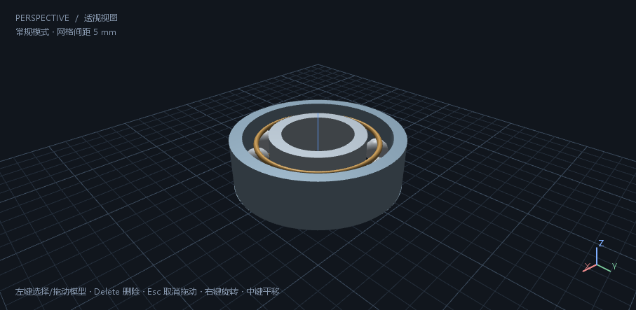
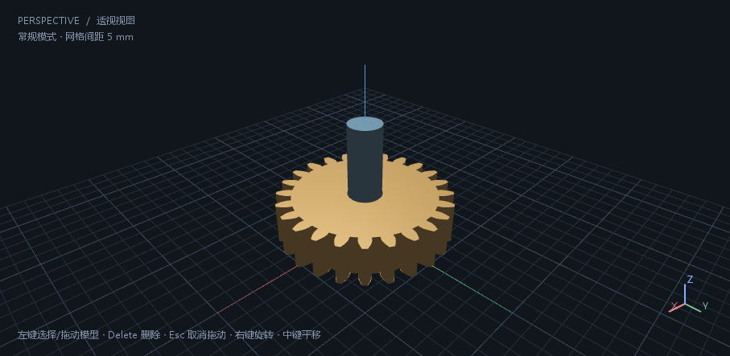
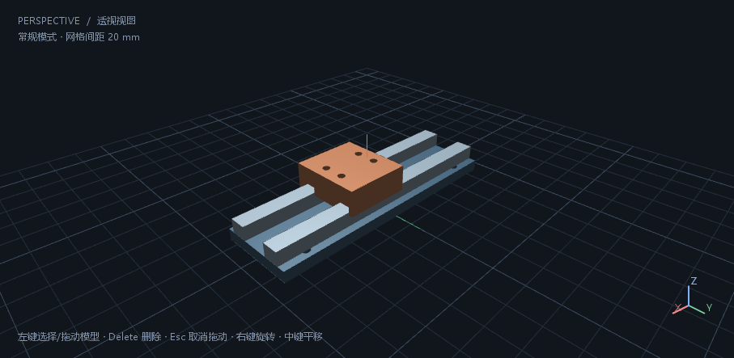

# 机械模型示例 · 1.0.1

通过菜单“示例”选择轴承、齿轮或导轨，也可直接打开 `.afcad`。单位为 mm。每个模型同时提供 STEP 实体和 GLB 网格，预览为软件实际渲染。

| 示例 | 构成和尺寸 | 适合学习 |
| --- | --- | --- |
| bearing | 14对象；轴承内径20、外径48、宽14；10颗Ø7滚珠，节圆Ø34 | 圆管、球、圆环、圆周阵列、同轴与沿轴偏移 |
| gear | 2对象；24齿、模数2、20°压力角、分度圆Ø48、齿顶Ø52、厚12、孔Ø10.4；轴Ø10×28 | 采样渐开线、闭合齿廓拉伸、孔布尔差、同轴 |
| linear-guide | 4对象；底板180×55×8，2条180×12×10导轨，45×50×18开槽滑块；底板4个Ø6孔，滑块4个Ø5孔 | 布尔开槽／打孔、平行关系、固定基准与位姿 |

## 预览





## 使用与编辑

- `.afcad` 保留对象、颜色、位姿和配合。轴承基本图元可在属性中编辑；布尔／拉伸形成的冻结实体可编辑外观和位姿，修改原始设计参数需重新运行生成器。
- STEP 保留可交换的实体与支持的外观信息，不承载本软件配合和撤销历史。
- GLB 是三角网格展示文件，不能作为实体布尔输入。示例网格含重复顶点，文件大小不等于几何拓扑复杂度。
- 轴承外圈／齿轮／导轨基准已固定，先取消固定或编辑配合再移动。导轨滑块仅演示平行关系，不是完整的单自由度滑动副，不含行程限位或动力学。

## 设计边界

这些是教学和功能展示模型，不是标准件制造图纸。轴承没有滚道沟槽、密封、游隙／接触求解和真实保持架兜孔，两个金色圆环只表示保持架位置。齿轮基圆以上采用采样渐开线，齿顶／齿根为折线近似，齿根径向过渡，没有加工圆角、变位、键槽、公差或强度校核。导轨采用矩形截面，没有滚珠循环和工业导轨接触结构。尺寸不表示符合任何特定国标或厂商规格。

## 重新生成

配置主工程时增加 `-DAXISFORGE_BUILD_EXAMPLE_GENERATOR=ON`，构建 `axisforge_examples`，在匹配的 Qt／OCCT 运行环境中运行：

```powershell
.\build\Release\axisforge_examples.exe examples/mechanical
```

生成器源码为 `tools/generate_examples.cpp`，会生成三个模型的项目、STEP和GLB，并重新导入核对对象数量。执行会覆盖指定目录中的同名模型，请为自己的修改另存文件。PNG预览来自桌面自检。回归测试另检查项目重载、实体体积、STEP／GLB读取和实际渲染。
